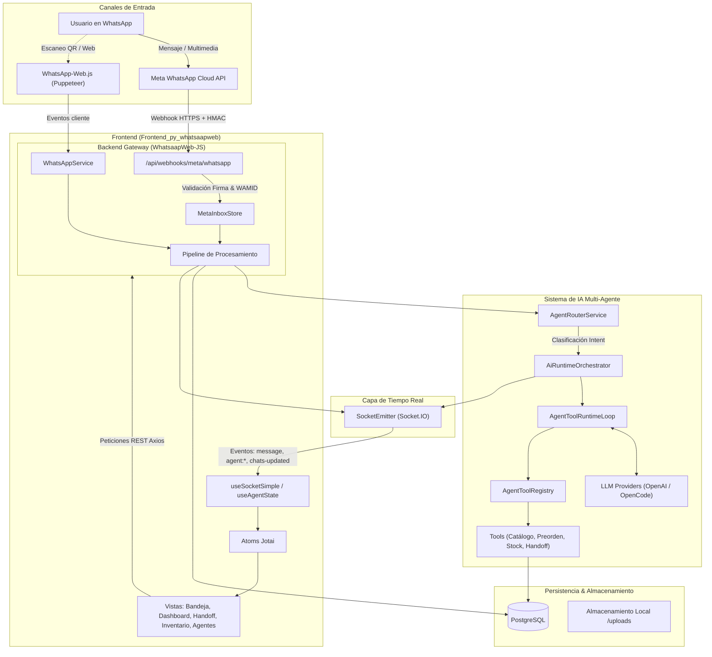
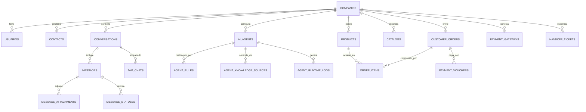
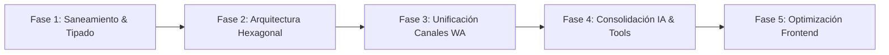

# BLUEPRINT ARQUITECTÓNICO Y CATÁLOGO DE CARACTERÍSTICAS
## Proyecto: Whatsap-Automat (Monorepo WhatsApp Business + IA Multi-Agente)

> **Documento maestro para refactorización mediante Modelos de Frontera (LLMs).**  
> Este documento consolida la arquitectura completa, modelos de datos, flujos de ejecución, contratos API, eventos Socket.IO, componentes del frontend, servicios del backend, deuda técnica acumulada y recomendaciones prioritarias de refactorización.

---

## 1. RESUMEN EJECUTIVO Y FICHA TÉCNICA

### 1.1 Naturaleza del Proyecto
**Whatsap-Automat** es una plataforma SaaS multi-empresa (Multi-Tenant) diseñada para la automatización operativa, comercial y de atención al cliente a través de **WhatsApp**. Integra una interfaz web inspirada en WhatsApp Web con un motor inteligente de orquestación multi-agente impulsado por Modelos de Lenguaje (LLMs), gestión de catálogos e inventarios, generación y validación de comprobantes de pago, y un sistema seguro de derivación a agentes humanos (*Handoff*).

### 1.2 Estructura del Monorepo
```
whatsap-automat/
├── Frontend_py_whatsaapweb/    # Aplicación SPA Frontend (React + Vite + TypeScript)
├── WhatsaapWeb-JS/             # Servidor API REST + WebSockets + Motor IA (Node.js + Express + TS)
├── AGENTS.md                   # Reglas operativas para asistentes de IA
├── README.md                   # Documentación inicial de despliegue y estructura
└── .gitignore                  # Configuración de exclusiones de archivos sensibles
```

### 1.3 Ficha Tecnológica

| Dimensión | Frontend (`Frontend_py_whatsaapweb`) | Backend (`WhatsaapWeb-JS`) |
| :--- | :--- | :--- |
| **Lenguaje / Runtime** | TypeScript 5.8, JavaScript (ESM) | TypeScript 6.0, Node.js (>= 18), CommonJS/ESM |
| **Framework Base** | React 18.3.1, Vite 7.1.2 | Express 5.1.0 (con soporte async nativo) |
| **Manejo de Estado** | Jotai 2.15.0 (Atoms modulares) | En memoria + PostgreSQL (`pg` 8.16.3) |
| **Estilos & UI** | Tailwind CSS 3.4.17, Lucide React | N/A (Headless API) |
| **Visores & Multimedia** | WaveSurfer.js 7, PDF.js, docx-preview, React-Player | fluent-ffmpeg, Multer 2.0 |
| **Comunicación en Vivo**| Socket.IO Client 4.8.1 | Socket.IO 4.8.1 (Rooms por chat y dashboard) |
| **Proveedor WhatsApp** | Consumo vía API Backend | Híbrido: Meta Cloud API (Oficial) / Baileys (Legacy) |
| **Motor de IA** | Consola de administración y pruebas | Runtime Multi-Agente (OpenAI / OpenCode compatible) |
| **Base de Datos** | N/A (Cliente HTTP Axios) | PostgreSQL con 40 migraciones SQL aditivas |
| **Seguridad** | JWT Bearer Tokens, Role-Based Access (Admin/User) | Helmet, Rate Limiter, HMAC-SHA256 Meta, AES-GCM Cipher |

---

## 2. ARQUITECTURA GLOBAL DEL SISTEMA (END-TO-END)



---

## 3. BACKEND (`WhatsaapWeb-JS`): ARQUITECTURA DETALLADA

### 3.1 Estructura Interna del Backend
El backend se encuentra estructurado en capas, con una arquitectura mixta (Domain-Driven Modules combinados con servicios centrales de mensajería):

```
WhatsaapWeb-JS/src/
├── app.ts                          # Ensamblado del servidor Express, middlewares, rutas y sockets
├── index.ts                        # Punto de arranque
├── config/                         # Configuraciones: DB, JWT, Meta Cloud, CORS, Rate Limit
├── db/
│   └── migrations/                 # 22 archivos SQL con 40 tablas estructuradas
├── middleware/                     # Autenticación JWT, Rate Limiter, Error Handler
├── models/                         # Modelos legacy y base (User.js)
├── routes/                         # Definición de rutas HTTP agrupadas por dominio
├── controllers/                    # Controladores HTTP
├── services/                       # Servicios core (WhatsAppService, SecretCipher, JWT)
│   ├── ai/                         # Servicios de IA y clientes de inferencia
│   └── whatsapp/                   # Soporte para Meta Cloud API (MetaInboxStore, MetaAccountStore)
├── sockets/                        # Controladores y emisores Socket.IO
├── shared/                         # Contratos e interfaces (UnitOfWorkPort, Queryable)
├── core/                           # Arquitectura hexagonal central (ConversationCore, DTOs, Ports)
└── modules/                        # Módulos desacoplados de negocio:
    ├── ai/                         # Orquestador, Router, Tools, Logs y Sesiones
    ├── companies/                  # Gestión Multi-tenant, configuraciones y dominios
    ├── conversations/              # Lógica de chats, mensajes y estados
    ├── customerHistory/            # Historial de compras, notas y perfiles de cliente
    ├── dashboard/                  # Métricas de rendimiento, KPIs y reportes agregados
    ├── inventory/                  # Productos, ítems comerciales, secciones y stock
    ├── operations/                 # Acciones operativas y auditoría
    ├── orders/                     # Órdenes de compra, pedidos e ítems
    ├── payments/                   # Pasarelas de pago, vouchers y webhooks
    └── reports/                    # Generación y exportación de reportes analíticos
```

### 3.2 El Motor de Inteligencia Artificial Multi-Agente
El módulo `src/modules/ai/` es el componente más avanzado del backend:

#### A. Enrutador Semántico (`AgentRouterService`)
- Evalúa el mensaje entrante y los últimos mensajes del historial del cliente.
- Clasifica la intención en 6 dominios principales:
  1. `customer_service`: Consultas generales y soporte básico.
  2. `sales_assistant`: Recomendaciones de productos e intención de compra.
  3. `inventory_stock`: Consultas específicas sobre disponibilidad física.
  4. `order_tracking`: Estado de despachos y pedidos pendientes.
  5. `preorder`: Solicitud explícita de formalizar un pedido.
  6. `handoff`: Solicitud o necesidad imperativa de un operador humano.
- Selecciona el agente (`AiAgent`) asignado y el dominio correspondiente (`company_ai_domains`).

#### B. Orquestador de Runtime (`AiRuntimeOrchestrator`)
- Valida el modo de la empresa (`automator_mode`):
  - `normal`: Solo asiste al operador humano (sugerencias sin auto-respuesta).
  - `mixed`: Auto-responde en dudas frecuentes y sugiere en ventas/pedidos.
  - `automator`: Automatización completa con envío directo de respuestas y fichas de producto.
- Comprueba si el chat se encuentra pausado para IA (`conversations.ia_paused = true` o presencia en `ia_pause_overrides`). Si está pausado, aborta inmediatamente el procesamiento del modelo.
- Inicia el bucle de ejecución agéntica (`AgentToolRuntimeLoop`).

#### C. Catálogo de Herramientas Reales (`Tools`)
Las herramientas ejecutan acciones acotadas y seguras mediante el `AgentToolRegistry`:
1. `availability.check`: Consulta horarios laborales y ventanas de atención sin alterar inventario.
2. `catalog.search` y `catalog.getItem`: Busca productos en catálogos activos asignados al agente.
3. `commercial_state.update`: Actualiza la etapa del cliente en el embudo comercial.
4. `handoff.create`: Genera un ticket en `handoff_tickets`, pausa la IA y notifica a los operadores por WebSocket.
5. `message.send_product_card`: Despacha fichas interactivas con imagen, precio, descripción y botón de acción.
6. `preorder.create`: Genera un borrador de orden en `customer_orders` con sus respectivos `order_items`.
7. `system_tag.assign`: Aplica etiquetas taxonómicas a la conversación para filtrado en la bandeja.

#### D. Proveedores de LLM y Factoría (`AiProviderFactory`)
- **`OpenCodeProvider`**: Compatible con el estándar de OpenAI / Ollama / modelos locales autohospedados.
- **`OpenAIProvider`**: Integración con endpoints de OpenAI utilizando la API moderna de respuestas, filtrado de salidas y saneamiento de prompts para evitar filtraciones de credenciales.

#### E. Seguridad, Auditoría y Trazas
- `AgentToolLogger` registra métricas de latencia, tokens utilizados, herramientas llamadas y confianza (`confidence`) en `agent_runtime_logs` y `ai_session_events`.
- No almacena información sensible ni cuerpos completos de respuestas confidenciales.

---

### 3.3 Modelo de Base de Datos (40 Tablas PostgreSQL)



#### Catálogo Completo de Tablas por Dominio:
1. **Multi-Tenancy y Accesos**:
   - `companies`: Identificador, razón social, estado, plan activo.
   - `usuarios`: Cuentas de operadores, administradores, hash bcrypt, roles (`ADMIN`, `USER`).
   - `plans` y `company_limits`: Límites de mensajes, agentes y almacenamiento por plan.
   - `company_settings`: Configuración de comportamiento (`automator_mode`, horarios).
2. **Mensajería y WhatsApp Inbox**:
   - `contacts`: Directorio de clientes (teléfono JID, nombre, pushname).
   - `conversations`: Estado de la conversación, último mensaje, asignación a operador, `ia_paused`.
   - `messages`: Registro de mensajes entrantes/salientes, wamid, tipo de medio, marcas temporales.
   - `message_attachments`: Metadatos de archivos adjuntos (mimetype, tamaño, ruta local).
   - `message_statuses`: Estados de entrega de Meta (`sent`, `delivered`, `read`, `failed`).
   - `whatsapp_business_accounts`: Credenciales cifradas de Meta Cloud API (`phone_number_id`, WABA ID).
   - `whatsapp_webhook_events`: Registro de eventos brutos recibidos para auditoría e idempotencia.
   - `whatsapp_message_templates`: Plantillas aprobadas por Meta para inicio de conversaciones.
3. **Inteligencia Artificial y Dominios**:
   - `ai_agents`: Agentes configurados, modelo asignado, temperatura, prompt del sistema.
   - `company_ai_domains`: Mapeo de agentes a dominios de negocio (`gestion_web`, `inventory_stock`, etc.).
   - `agent_prompt_profiles`: Perfiles de personalidad y comportamiento.
   - `agent_knowledge_sources`: Base de conocimientos en texto y documentos indexados.
   - `agent_rules`: Reglas estrictas de validación y restricciones operativas.
   - `agent_test_runs`: Pruebas de simulación unitarias del agente.
   - `agent_runtime_logs`: Métricas de ejecución, herramientas utilizadas y nivel de certeza.
   - `ai_chat_sessions`, `ai_session_turns`, `ai_session_events`: Sesiones de diálogo persistentes.
   - `ia_pause_overrides`: Pausas manuales de IA con fecha de expiración automática.
4. **Catálogo Comercial, Inventario y Pedidos**:
   - `products`: Maestro de artículos comerciales (nombre, SKU, precio, costo, stock actual, stock mínimo).
   - `product_images`: Galería de fotos vinculadas a cada producto.
   - `catalogs`, `catalog_items`, `catalog_sections`: Agrupaciones temáticas para agentes de venta.
   - `stock_movements`: Kardex de inventario (entradas, salidas, ajustes automáticos).
   - `customer_orders`: Pedidos creados por agentes o humanos (subtotal, impuestos, total, estado).
   - `order_items`: Detalle de productos por orden con precios congelados al momento de venta.
   - `operational_actions`: Registro de auditoría de modificaciones operativas.
5. **Pagos, Pasarelas y Comprobantes**:
   - `payment_gateways`: Proveedores integrados (MercadoPago, Stripe, PayPal, Transferencia manual).
   - `payment_vouchers`: Comprobantes cargados, estado de validación, URLs de link de pago.
   - `payment_webhook_events`: Notificaciones IPN/Webhooks de pasarelas de pago.
6. **Handoff y Soporte**:
   - `handoff_tickets`: Cola de atención para agentes humanos (motivo, operador asignado, estado).
7. **Taxonomía**:
   - `tags`, `tag_chats`, `tag_users`: Etiquetas de color para clasificación y filtrado de chats.

---

### 3.4 Inventario Exhaustivo de Rutas y Endpoints de la API

| Prefijo / Ruta | Método | Protección | Propósito |
| :--- | :---: | :---: | :--- |
| **`/api/auth`** | | | |
| `/api/auth/login` | POST | Pública | Inicio de sesión, retorna JWT access token |
| `/api/auth/register` | POST | Pública | Registro de usuario |
| `/api/auth/refresh` | POST | Pública | Renovación de token de sesión |
| `/api/auth/me` | GET | `requireJwt` | Perfil del usuario autenticado |
| **`/api/webhooks/meta/whatsapp`** | | | |
| `/api/webhooks/meta/whatsapp` | GET | Pública | Verificación de Webhook Meta (`hub.challenge`) |
| `/api/webhooks/meta/whatsapp` | POST | HMAC-SHA256 | Ingesta de mensajes y estados de entrega entrantes |
| **`/api/chats` & `/api/conversations`** | | | |
| `/api/chats` | GET | `optionalJwt` | Lista de conversaciones con último mensaje y badge |
| `/api/chats/:chatId/messages` | GET | `optionalJwt` | Historial paginado de mensajes de un chat |
| `/api/chats/:chatId/messages` | POST | `optionalJwt` | Envío de mensaje de texto o multimedia |
| `/api/chats/:chatId/read` | POST | `optionalJwt` | Marca mensajes como leídos |
| `/api/chats/ia/pause` | POST | `requireJwt` | Pausa temporal de IA en un chat determinado |
| `/api/chats/ia/resume` | POST | `requireJwt` | Reanuda la atención de la IA en el chat |
| **`/api/agents`** | | | |
| `/api/agents` | GET / POST | `requireJwt` | Listado y creación de agentes de IA |
| `/api/agents/:id` | GET / PUT / DEL | `requireJwt` | Detalle, actualización y borrado de agentes |
| `/api/agents/:id/knowledge` | GET / POST | `requireJwt` | Gestión de fuentes de conocimiento |
| `/api/agents/:id/test` | POST | `requireJwt` | Ejecución en playground / simulador de prueba |
| `/api/company/ai-domains` | GET / PUT | `requireJwt` | Mapeo de agentes a los 6 dominios IA |
| **`/api/products` & `/api/catalogs`**| | | |
| `/api/products` | GET / POST | `requireJwt` | Catálogo de productos e inventario |
| `/api/products/:id` | GET / PUT / DEL | `requireJwt` | CRUD de producto individual |
| `/api/catalogs` | GET / POST | `requireJwt` | Gestión de catálogos comerciales |
| `/api/catalogs/:id/sections` | GET / POST | `requireJwt` | Estructuración por secciones |
| **`/api/orders`** | | | |
| `/api/orders` | GET / POST | `requireJwt` | Listado y formalización de órdenes de compra |
| `/api/orders/:id/status` | PATCH | `requireJwt` | Cambio de estado de la orden (pendiente, pagado, etc.) |
| **`/api/payments`** | | | |
| `/api/payments/gateways` | GET / POST | `requireJwt` | Configuración de pasarelas (MercadoPago / Stripe) |
| `/api/payments/vouchers` | GET / POST | `requireJwt` | Carga y revisión de comprobantes de pago |
| `/api/payments/vouchers/:id/verify` | POST | `requireJwt` | Aprobación o rechazo de comprobante |
| `/api/webhooks/payments/:gateway` | POST | Firma Gateway | Recepción de notificaciones de pago automáticas |
| **`/api/dashboard` & `/api/reports`**| | | |
| `/api/dashboard/stats` | GET | `requireJwt` | Contadores KPI (mensajes, ventas, handoffs, IA) |
| `/api/dashboard/handoff` | GET | `requireJwt` | Lista de tickets de derivación humana pendientes |
| `/api/dashboard/handoff/:id/take`| POST | `requireJwt` | Operador toma el ticket de atención |
| `/api/dashboard/handoff/:id/close`| POST | `requireJwt` | Cierre del ticket de soporte |
| `/api/reports` | GET | `requireJwt` | Métricas avanzadas para gráficos y exportación |
| **`/api/whatsapp`** | | | |
| `/api/whatsapp/status` | GET | `optionalJwt` | Estado de la conexión (Cloud API o Baileys) |
| `/api/whatsapp/qr` | GET | `optionalJwt` | Obtención de código QR para sesión Baileys |
| `/api/whatsapp/templates` | GET / POST | `optionalJwt` | Sincronización de plantillas aprobadas por Meta |

---

## 4. FRONTEND (`Frontend_py_whatsaapweb`): ARQUITECTURA DETALLADA

### 4.1 Organización de Módulos y Rutas
La aplicación está organizada bajo el directorio `src/factures/` (término legado para *features*):

```
Frontend_py_whatsaapweb/src/
├── main.tsx                        # Punto de entrada ReactDOM
├── App.tsx                         # Contenedor raíz
├── routes/
│   └── AppRoutes.tsx               # Definición de rutas, navegación y PrivateRoute
├── jotai/                          # Estados globales (Atoms)
│   ├── slices/                     # tema, auth, agentes, configuración
│   └── middleware/                 # Sincronización de roles y persistencia
├── shared/                         # Componentes comunes, Axios interceptors, tipos
├── utils/                          # SocketService, utilidades de formato, storage
└── factures/                       # Módulos de la aplicación:
    ├── auth/                       # Login, Registro, Olvido de contraseña
    ├── mensajeria/                 # Bandeja central tipo WhatsApp Web
    ├── dashboard/                  # Panel analítico, Pagos, Handoff
    ├── agentes/                    # Configuración de Dominios y Agentes IA
    ├── inventario/                 # Catálogos, Productos, Stock y Precios
    ├── estaciones/                 # Canales de WhatsApp, QR y estado
    ├── permisos/                   # Control de acceso basado en roles y tags
    ├── setting/                    # Configuración general y de empresa
    ├── estadisticos/               # Reportes y analítica avanzada
    └── landing/                    # Página de presentación pública
```

### 4.2 Módulo de Mensajería Omnicanal (`src/factures/mensajeria`)
Es la réplica operacional de WhatsApp Web:
- **`Inicio.tsx`**: Orquestador principal de la vista de chat. Divide la pantalla en sidebar lateral y panel activo.
- **`ChatSidebar.tsx`**: Lista de conversaciones activas con:
  - Búsqueda en tiempo real por nombre, teléfono o contenido.
  - Filtros por etiquetas (`tags`), mensajes no leídos y chats pausados.
  - Indicadores de estado de entrega (reloj, check simple, doble check azul).
- **`MessagesPanel.tsx`**: Flujo de conversación que incluye:
  - Renderizado virtualizado de mensajes.
  - Soporte multimedia completo: fotos, videos (`React-Player`), audios con visualizador de espectro (`wavesurfer.js`), previsualización de documentos PDF (`@react-pdf-viewer`) y Word (`docx-preview`).
  - Despacho de notas de voz grabadas en el navegador.
  - Inserción de emojis con `@emoji-mart`.
  - Botón de control manual de IA: permite al operador humano pausar o reanudar el bot en la conversación con un solo clic.
- **`CustomerHistoryPanel.tsx`**: Drawer lateral que despliega la información del cliente, historial de compras, notas internas y tickets de soporte.

### 4.3 Módulo de Dashboard y Operaciones (`src/factures/dashboard`)
Panel gerencial y de supervisión operativa:
- **`DashboardPage.tsx`**: Métricas en tiempo real sobre volumen de mensajes, tiempos de respuesta, tasa de resolución de la IA y órdenes generadas.
- **`HandoffPage.tsx`**: Centro de control de tickets humanos. Permite a los agentes visualizar clientes en espera, tomar el control del chat y marcar el caso como resuelto.
- **`PaymentsPage.tsx`**: Bandeja de validación de comprobantes de pago. Muestra la imagen del voucher, los montos extraídos, la orden asociada y los botones de aprobación/rechazo.

### 4.4 Módulo de Inteligencia Artificial (`src/factures/agentes`)
- **`AiDomainsPage.tsx`**: Configuración de los 6 dominios de negocio. Permite asignar qué agente atiende cada área y activar/desactivar dominios.
- **`AgentsPage.tsx`**: Constructor de agentes. Edición de instrucciones del sistema, asignación de catálogos permitidos, reglas operativas y selección de modelo.
- **`AgentTestSessionPage.tsx`**: Consola interactiva para simular conversaciones con el agente antes de pasarlo a producción.

---

## 5. TIEMPO REAL: CONTRATO DE EVENTOS SOCKET.IO

El sistema mantiene una sincronización bidireccional continua mediante Socket.IO:

| Nombre del Evento | Origen | Destino | Payload Principal | Propósito |
| :--- | :---: | :---: | :--- | :--- |
| `connect` / `reconnect` | Cliente | Servidor | Token JWT en auth header | Autenticación y unión a rooms de empresa |
| `message` | Servidor | Cliente (Room) | `{ id, chatId, body, fromMe, timestamp, mediaUrl, ... }` | Nuevo mensaje recibido o enviado |
| `message-replaced` | Servidor | Cliente (Room) | `{ oldId, newId, status }` | Reemplazo de ID temporal por WAMID definitivo |
| `chats-updated` | Servidor | Broadcast | `Array<ChatSummary>` | Actualización de contadores o lista de chats |
| `agent:typing` | Servidor | Cliente (Room) | `{ chatId, agentId }` | Indica que el agente de IA está procesando |
| `agent:suggestion` | Servidor | Cliente (Room) | `{ chatId, text, confidence, agentId }` | Sugerencia de respuesta para operador humano |
| `agent:auto_reply_sent` | Servidor | Cliente (Room) | `{ chatId, messageId, body }` | Notificación de mensaje automático enviado por IA |
| `agent:blocked` | Servidor | Cliente (Room) | `{ chatId, reason }` | IA bloqueada por reglas de seguridad |
| `agent:handoff` | Servidor | Dashboard/Room | `{ ticketId, chatId, reason }` | Creación de ticket de derivación humana |
| `agent:paused` / `:resumed` | Servidor | Cliente (Room) | `{ chatId, paused, pausedBy }` | Estado del interruptor de IA en el chat |
| `payment-created` | Servidor | Dashboard/Room | `{ voucherId, chatId, amount }` | Nuevo voucher subido para validación |
| `payment-updated` | Servidor | Dashboard/Room | `{ voucherId, status }` | Comprobante aprobado o rechazado |
| `order-status-changed` | Servidor | Dashboard/Room | `{ orderId, status }` | Cambio de estado de un pedido |
| `stock-updated` | Servidor | Dashboard/Room | `{ productId, newStock }` | Actualización de existencias de inventario |
| `qr` | Servidor | Cliente (Admin) | `{ qr: string }` | Código QR para conexión Baileys |
| `session_status` | Servidor | Cliente (Admin) | `{ status: 'CONNECTED' \| 'DISCONNECTED' }` | Estado de la conexión WhatsApp |

---

## 6. DEUDA TÉCNICA E INCONSISTENCIAS CRÍTICAS IDENTIFICADAS

Para una refactorización de alto impacto por parte de un modelo grande, se deben tener en cuenta las siguientes anomalías encontradas en el código:

### 6.1 Contaminación de Dependencias en el Frontend
- **Problema**: En el archivo `Frontend_py_whatsaapweb/package.json` están declaradas dependencias exclusivas de backend:
  - `"express": "^5.1.0"`
  - `"body-parser": "^2.2.0"`
  - `"whatsapp-web.js": "^1.34.4"`
- **Impacto**: Confusión arquitectónica e incremento innecesario en dependencias.
- **Acción**: Eliminar estas 3 dependencias del frontend inmediatamente.

### 6.2 Convención de Nomenclatura del Frontend (`factures` vs `features`)
- **Problema**: Toda la estructura modular del frontend reside en la carpeta `src/factures/` en lugar del estándar de la industria `src/features/`.
- **Acción**: Renombrar de forma coordinada el directorio y actualizar todos los imports relativos.

### 6.3 Hibridez de Lenguajes en el Backend (JS y TS mezclados)
- **Problema**: El backend mezcla archivos TypeScript modernos (`src/app.ts`, `src/modules/*`) con archivos JavaScript antiguos bajo CommonJS (`src/models/User.js`, `src/routes/authRoutes.js`, `src/routes/chatRoutes.js`, `src/routes/mediaRoutes.js`, `src/sockets/socketHandler.js`).
- **Acción**: Migrar el 100% de los archivos `.js` a TypeScript estricto (`.ts`).

### 6.4 Coexistencia de Canales WhatsApp (Meta Cloud API vs Baileys/Puppeteer)
- **Problema**: Existen dos implementaciones dispares para interactuar con WhatsApp: la oficial de Meta (`MetaInboxStore.ts` con webhooks) y la basada en navegador headless (`whatsapp-web.js` / Puppeteer). Esto genera código de compatibilidad engorroso en `chatCompatRoutes.ts` y controladores duplicados.
- **Acción**: Abstraer la capa de mensajería bajo un patrón Adapter unificado (`WhatsAppChannelPort`) donde Meta Cloud API sea el driver principal y Baileys sea un driver alternativo desacoplado.

### 6.5 Nombres de Paquetes en `package.json`
- **Frontend**: Figura con el nombre `"silvaprojets"`. Debería ser `"whatsap-automat-frontend"`.
- **Backend**: Figura con el nombre `"mensajeria-api"`. Debería ser `"whatsap-automat-backend"`.

---

## 7. PLAN RECOMENDADO DE REFACTORIZACIÓN PARA EL MODELO GRANDE

El modelo grande encargado de refactorizar el proyecto debe seguir esta secuencia estricta en fases:



1. **Fase 1: Saneamiento de Dependencias y Tipado Completo**
   - Limpiar dependencias del frontend (`express`, `whatsapp-web.js`, `body-parser`).
   - Migrar todos los archivos `.js` del backend a TypeScript estricto con interfaces DTO tipadas.
   - Establecer `npm workspaces` o `pnpm workspaces` formalizando un paquete `@whatsap/shared` para tipos compartidos entre frontend y backend (ej: DTOs de mensajes, órdenes y agentes).

2. **Fase 2: Consolidación Arquitectónica del Backend**
   - Unificar la estructura de `src/core` y `src/modules` bajo una arquitectura hexagonal consistente (Domain, Application, Infrastructure).
   - Estandarizar la inyección de dependencias y el uso del `UnitOfWorkPort` para transacciones seguras en PostgreSQL.

3. **Fase 3: Capa de Abstracción de Canales WhatsApp**
   - Crear una interfaz única `IWhatsAppChannel` con métodos: `sendMessage`, `sendMedia`, `sendProductCard`, `setTyping`, `markAsRead`.
   - Implementar `MetaCloudChannelAdapter` y `BaileysChannelAdapter` respetando el mismo contrato, eliminando código legacy disperso en controladores.

4. **Fase 4: Perfeccionamiento del Motor IA**
   - Mantener el desacoplamiento de herramientas en `AgentToolRegistry`.
   - Fortalecer la observabilidad del ciclo de vida de los agentes mediante trazas estructuradas.
   - Reforzar la verificación de stock transaccional antes de la emisión de preórdenes.

5. **Fase 5: Reorganización y Optimización del Frontend**
   - Renombrar `src/factures/` a `src/features/`.
   - Implementar `React.lazy` y code-splitting en rutas pesadas (visores de documentos PDF/DOCX y Wavesurfer).
   - Homogeneizar el manejo de estado con Jotai y custom hooks especializados.
