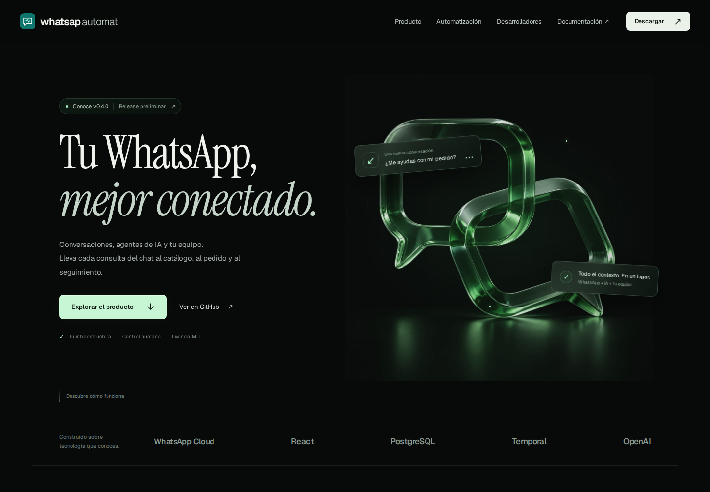
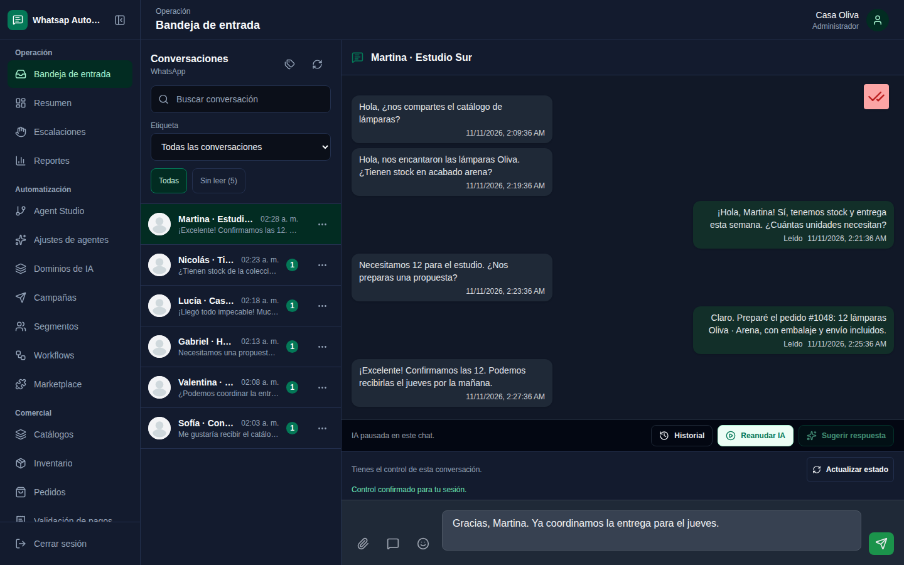
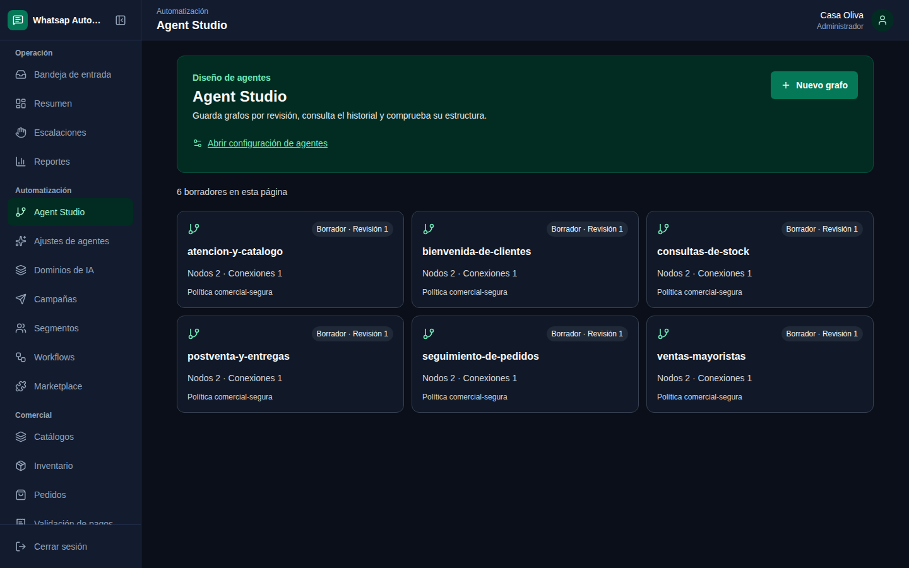

<div align="center">

# Whatsap-Automat

### Tu WhatsApp, mejor conectado.

Conversaciones, agentes de IA y tu equipo, en una plataforma que puedes alojar en tu infraestructura.

[Explorar la web](http://glendervargas.me/whatsap-automat/) · [Documentación](http://glendervargas.me/whatsap-automat/docs.html) · [Release v0.4.0](https://github.com/glender222/whatsap-automat/releases/tag/v0.4.0)

[](https://github.com/glender222/whatsap-automat/actions/workflows/ci.yml) · [Licencia MIT](LICENSE)



</div>

## Del mensaje al siguiente paso

Whatsap-Automat reúne la atención por WhatsApp, el contexto comercial y la configuración de agentes. El operador puede consultar el historial, tomar el control de una conversación y continuar la atención. En Agent Studio, el equipo diseña, evalúa y publica revisiones para los perfiles de ejecución compatibles.

| Para tu equipo | Para quienes integran |
| --- | --- |
| Historial persistido y estados de entrega | API REST, OpenAPI 3.1 y eventos con Socket.IO |
| Sugerencias de IA y respuesta automática según configuración | SDK de TypeScript y Python, y CLI |
| Catálogo, pedidos y comprobantes relacionados con la atención | Contratos tipados, versiones e idempotencia en operaciones compatibles |
| Control humano, permisos y espacios por empresa | Backend Express, PostgreSQL y web React en el mismo repositorio |

### Una bandeja con contexto

Consulta las conversaciones y retoma el trabajo con el historial disponible. Las sugerencias de IA se revisan antes de enviar; el modo automático requiere una revisión publicada y vinculada a WhatsApp, junto con los permisos y el estado de conversación vigentes.



### Agentes con una revisión identificable

Agent Studio permite trabajar con grafos versionados y evaluaciones. Los perfiles de texto y catálogo tienen recorridos documentados de publicación y uso en WhatsApp. La publicación conserva evidencia de la revisión y la ejecución comprueba la autoridad vigente.



Las capturas muestran la aplicación web con datos de demostración. Explora la [presentación interactiva](http://glendervargas.me/whatsap-automat/) para ver las vistas del producto y los ejemplos de integración.

## Primera entrega de QA · v0.4.0

Esta es una **release preliminar centrada en WhatsApp**. El repositorio es privado: clonar el código y acceder a sus releases o ejecuciones de Actions requiere una cuenta de GitHub autorizada. La distribución del portal y de los artefactos se gestiona desde GitHub.

- **Web y backend:** los recorridos de QA cubren persistencia, permisos, aislamiento entre empresas, mensajería y automatización con los alcances registrados por cada suite.
- **Proveedores:** existe evidencia con servicios locales controlados y una línea real de Meta. Siguen pendientes la prueba con dos líneas reales y los pilotos autorizados de OpenAI y Mercado Pago.
- **Pagos:** el alcance disponible es la conciliación interna administrativa. Mercado Pago requiere habilitación explícita; la validación con proveedor autorizado, el checkout público y sus webhooks siguen pendientes.
- **Móvil:** la release incluye un APK Android ARM64 firmado para QA. La ejecución nativa en dispositivo queda pendiente y la compilación iOS requiere un entorno con Xcode.

El alcance de esta entrega no acredita una operación omnicanal completa ni una instalación lista para producción. Consulta el [plan de validación](docs/roadmap/PRODUCT_VALIDATION_PLAN.md) y la [evidencia del APK](docs/qa/MOBILE_ANDROID_QA_2026-11-11.md) antes de evaluar un despliegue.

## Pruébalo en tu entorno

En Linux (laptop o VM de Azure), necesitas Git con acceso al repositorio y Docker Engine con Compose v2. Node.js, npm, Python, PostgreSQL, FFmpeg y Playwright se ejecutan en contenedores con las versiones fijadas por el repositorio.

```bash
git clone --branch main https://github.com/glender222/whatsap-automat.git
cd whatsap-automat
./dev setup
./dev up
./dev doctor
```

Abre `http://localhost:5173` e inicia sesión con `demo@automat.local` / `Demo-local-2026!`. La API usa `http://localhost:3000` y su visor está en `/api/v1/docs`. La demo utiliza la API real, JWT y PostgreSQL con RLS; contiene datos sintéticos de dos empresas y credenciales locales, sin activar proveedores externos.

`./dev setup` genera `.dev/local/dev.env` privado e ignorado por Git, sin reemplazar los `.env` existentes. En ejecuciones posteriores detiene API y web mientras prepara las dependencias; vuelve a ejecutar `up` después. Si necesitas otros puertos, cambia `DEV_WEB_PORT` y `DEV_API_PORT` en ese archivo antes de `./dev up`. Los puertos se publican solo en localhost; cada checkout conserva su propia base y dependencias.

```bash
./dev check   # Validaciones de código y pruebas
./dev smoke   # Recorrido web y persistencia tras reiniciar
./dev down    # Detiene el entorno y conserva sus volúmenes
```

Consulta la [guía de desarrollo](docs/development.md) para Azure, diagnóstico, móvil, Temporal y el uso explícito de proveedores reales. El tag `v0.4.0` conserva la primera entrega de QA; esta ruta `./dev` corresponde a `main`.

## Desarrollo y verificación

| Directorio | Contenido |
| --- | --- |
| [Frontend_py_whatsaapweb/](Frontend_py_whatsaapweb/) | Espacio de trabajo web en React, Vite y TypeScript |
| [WhatsaapWeb-JS/](WhatsaapWeb-JS/) | API, canales, runtime de agentes y persistencia |
| [apps/mobile/](apps/mobile/) | Cliente Expo y React Native |
| [packages/](packages/) | Contratos, SDK y CLI |
| [docs-site/](docs-site/) | Presentación web, documentación y descargas |

Desde la raíz, ejecuta las comprobaciones dentro del entorno reproducible:

```bash
./dev check
./dev smoke
```

Las suites de integración requieren sus servicios y variables de entorno. Consulta los [criterios de QA](docs/qa/QA_GATES_AND_CASES.md) y los [resultados de CI del commit elegido](https://github.com/glender222/whatsap-automat/actions/workflows/ci.yml); la evidencia de proveedores y dispositivos se verifica por separado.

## Documentación y colaboración

[Blueprint v0.4](docs/architecture/BLUEPRINT_v0.4.md) · [Roadmap v1.0](docs/architecture/ROADMAP_V1.0.md) · [API y compatibilidad](docs/api/README.md) · [Temporal](deploy/temporal/README.md) · [Compilar el portal](docs-site/README.md)

Para contribuir, sigue [CONTRIBUTING.md](CONTRIBUTING.md) y el [código de conducta](CODE_OF_CONDUCT.md). Reporta vulnerabilidades por el canal privado descrito en [SECURITY.md](SECURITY.md).

El [SBOM CycloneDX](sbom.json) inventaría las dependencias npm de los seis lockfiles. Regénéralo con `bash scripts/sbom-generate.sh` y compruébalo con `node --test scripts/sbom-generate.test.cjs`; los artefactos compilados y las dependencias del sistema se auditan por separado.

Código bajo [licencia MIT](LICENSE). Consulta la [release v0.4.0 y sus artefactos de QA](https://github.com/glender222/whatsap-automat/releases/tag/v0.4.0) para evaluar una versión identificable.
