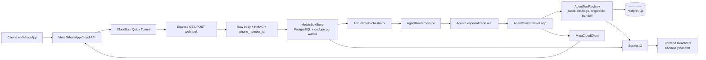

# Plataforma multiagente para WhatsApp

MVP de OpenAI Build Week para atención al cliente, ventas, consulta de stock, prepedidos y escalamiento humano. El backend conserva dos proveedores de canal: Meta WhatsApp Cloud API para la demo real y `whatsapp-web.js` como flujo legacy.

## Arquitectura real del MVP



Recorrido principal:

1. Meta entrega un evento firmado a `POST /api/webhooks/meta/whatsapp`.
2. El backend valida el HMAC sobre el cuerpo crudo y resuelve la empresa por `phone_number_id`.
3. `MetaInboxStore` persiste el mensaje y evita reejecutar un `wamid` duplicado.
4. `AiRuntimeOrchestrator` usa `AgentRouterService` para clasificar atención, venta, inventario, pedido, prepedido o handoff.
5. El agente seleccionado ejecuta únicamente las tools permitidas por su modo, módulos y alcance de catálogo.
6. La respuesta vuelve por Meta Cloud API. PostgreSQL y Socket.IO actualizan la bandeja, el prepedido o el handoff del frontend.

## Requisitos

- Node.js 20 o superior y npm.
- PostgreSQL accesible desde el backend.
- `cloudflared` en el `PATH`, en `.tools/cloudflared/cloudflared`, o indicado con `CLOUDFLARED_BIN`.
- Una app de Meta Developers con el producto WhatsApp configurado.
- Una API key de OpenAI para `AI_PROVIDER=openai`, o una configuración OpenCode alternativa.

## Instalación y variables de entorno

Desde la raíz del repositorio backend (`WhatsaapWeb-JS`):

```bash
PUPPETEER_SKIP_DOWNLOAD=true npm ci
cp .env.example .env
```

Completa `.env` localmente. Nunca lo publiques ni lo pegues en tickets, chats o commits.

Obligatorias para todo arranque:

- `DB_PASSWORD`
- `JWT_SECRET`, aleatorio y con al menos 32 caracteres

Obligatorias cuando `WHATSAPP_PROVIDER=meta-cloud`:

- `META_GRAPH_VERSION`
- `META_WA_PHONE_NUMBER_ID`
- `META_WABA_ID`
- `META_WA_ACCESS_TOKEN`
- `META_WEBHOOK_VERIFY_TOKEN`, aleatorio y con al menos 16 caracteres
- `META_APP_SECRET`
- `META_TOKEN_ENCRYPTION_KEY`, independiente del JWT y con al menos 32 caracteres

`META_WA_DISPLAY_PHONE_NUMBER` es descriptiva. `DEFAULT_COMPANY_ID` identifica la empresa donde se registra la cuenta configurada por entorno; no se utiliza como fallback para webhooks con un `phone_number_id` desconocido.

Para producción, compila con las dependencias de desarrollo y prepara el entorno de ejecución con `npm ci --omit=dev`. Ejecuta `npm start` con `NODE_ENV=production` y `WHATSAPP_PROVIDER=meta-cloud`. El adaptador Web.js y el servidor legacy quedan disponibles en desarrollo. Si vas a probar la conexión legacy, instala sin `PUPPETEER_SKIP_DOWNLOAD` para incluir su navegador.

Desde la raíz del repositorio frontend (`Frontend_py_whatsaapweb`), en otra terminal:

```bash
npm install
cp .env.example .env
```

Su única variable es:

```env
VITE_API_URL=http://localhost:3000/api
```

Los `.env` reales están ignorados en ambos proyectos. Los `.env.example` contienen nombres y valores de desarrollo no secretos.

## PostgreSQL

Configura en `.env` una base existente y un usuario con permisos para crear/actualizar el esquema:

```env
DB_HOST=localhost
DB_PORT=5432
DB_NAME=whatsapp_empresas
DB_USER=postgres
DB_PASSWORD=
```

Luego aplica las migraciones existentes, sin reescribirlas:

```bash
npm run db:migrate
npm run db:status
```

Los scripts actuales informan de forma legible cuando PostgreSQL no está disponible, pero pueden terminar sin un código de error. Para dar este paso por válido, revisa la salida y confirma que la conexión y todas las migraciones aparecen aplicadas; no aceptes un mensaje de “PostgreSQL no disponible” como éxito.

## OpenAI y OpenCode

Para OpenAI:

```env
AI_PROVIDER=openai
OPENAI_API_KEY=
OPENAI_MODEL=
OPENAI_REQUEST_TIMEOUT_MS=30000
```

El proveedor implementa la interfaz existente y llama a la [Responses API oficial de OpenAI](https://developers.openai.com/api/docs/guides/text). No registra API keys, prompts completos ni respuestas completas. `OPENAI_MODEL` es obligatorio para arrancar con `AI_PROVIDER=openai` y se usa cuando el agente no define otro modelo.

Los agentes nuevos heredan `AI_PROVIDER`. Los agentes ya persistidos conservan su `provider` y `model`: antes de la demo revisa que el router y cada especialista estén configurados como `openai` y con un modelo válido. El cambio de entorno no modifica registros existentes silenciosamente.

OpenCode continúa disponible:

```env
AI_PROVIDER=opencode
OPENCODE_API_URL=
OPENCODE_API_KEY=
OPENCODE_MODEL=
```

## Preparar los agentes de la demo

El runtime no inventa agentes ni catálogo. En una base limpia, prepara la demo en este orden:

1. Arranca backend y frontend, abre `/auth/register`, registra el administrador e inicia sesión.
2. Para usar endpoints protegidos desde Swagger (`/api/docs`), copia el JWT de esa sesión en **Authorize > BearerAuth**. No guardes el token en documentación ni commits.
3. Confirma el ID de empresa con `GET /api/company/me`, detén el backend, coloca ese ID en `DEFAULT_COMPANY_ID` y vuelve a iniciarlo. La configuración y la cuenta Meta se cargan durante el arranque; no reutilices un proceso iniciado con otro tenant.
4. En `/dashboard/catalogos`, crea y activa al menos un catálogo y una sección.
5. En `/dashboard/inventario`, crea un producto activo, asígnalo al catálogo y registra disponibilidad/stock real.
6. Crea el router de desarrollo con `npx tsx scripts/seed-router-dev.ts`, o crea el equivalente con JWT desde `POST /api/agents`. El script usa `AI_PROVIDER` y el modelo configurado y no reemplaza un router activo.
7. En `/dashboard/ia/agentes` o en Swagger autenticado, prepara y activa como mínimo:

   - un agente `router`, activo;
   - un agente `support` o `general` para atención general;
   - un agente `sales_assistant` con catálogo, stock, pedidos y alcance de catálogo para ventas/prepedidos;
   - un agente `operations` con catálogo para inventario/stock;
   - un agente `order_tracking` u `operations` para pedidos existentes.

8. Asigna a ventas/operaciones el catálogo o sección creados; un agente sin scope no puede consultar inventario.
9. Con el JWT de administrador, establece `{"mode":"automator"}` en `PUT /api/agents/company-mode`. Compruébalo con `GET /api/agents/company-mode`.
10. Prueba el proveedor con `POST /api/agents/provider/test`. El router debe tener `status=active`, un modo distinto de `disabled`, `provider=openai` y modelo válido. Cada especialista que deba responder solo necesita además `mode=auto`.

Para respuestas automáticas por WhatsApp, el agente destino debe estar activo y en modo `auto`. En modo `suggest`, la respuesta se envía al frontend para revisión humana. El handoff solo se comunica al cliente cuando existe un ticket persistido y reutiliza un ticket activo de la conversación.

## Ejecutar el backend

Sin túnel:

```bash
npm run dev
```

Comprueba el proceso y que PostgreSQL tenga todas las migraciones del build.

```bash
curl --fail http://127.0.0.1:3000/health
curl --fail http://127.0.0.1:3000/ready
```

`/health` comprueba que el proceso responde. `/ready` devuelve `503` si PostgreSQL no está disponible o falta una migración. El diagnóstico autenticado comprueba también las dependencias configuradas. Usa `HOST=127.0.0.1` para desarrollo local. En un contenedor detrás de un proxy, configura `HOST=0.0.0.0`.

## Automatizaciones duraderas por webhook

Aplica la migración `033_durable_workflow_dispatch.sql` con `npm run db:migrate` y compila con `npm run build`. El backend acepta los webhooks y guarda la ejecución con su revisión publicada. Un proceso independiente lee el outbox, inicia el workflow en Temporal y guarda sus estados en PostgreSQL. Ambos procesos usan las mismas variables de PostgreSQL. Configura `TEMPORAL_ADDRESS` y `TEMPORAL_NAMESPACE` para el worker. Para TLS, usa `TEMPORAL_TLS=true`. Con una CA privada o mTLS, monta los archivos y configura `TEMPORAL_TLS_CA_FILE`, `TEMPORAL_TLS_CERT_FILE` y `TEMPORAL_TLS_KEY_FILE`. El relay y el worker comparten la misma configuración de conexión.

Para una prueba local, inicia Temporal en una terminal y el worker en otra. Mantén también el backend en ejecución.

```bash
temporal server start-dev --ip 127.0.0.1 --headless
```

```bash
TEMPORAL_ADDRESS=127.0.0.1:7233 node dist/services/temporal/automationWorker.js
```

Con un JWT de administrador de la empresa, crea un workflow con `POST /api/v1/workflows`. El cuerpo incluye `name`, `dagGraph` y, opcionalmente, `limits`. Este grafo espera 500 ms antes de completar.

```json
{
  "name": "Espera breve",
  "dagGraph": {
    "nodes": [
      { "id": "inicio", "kind": "trigger" },
      { "id": "espera", "kind": "delay", "config": { "durationMs": 500 } },
      { "id": "fin", "kind": "end" }
    ],
    "edges": [
      { "id": "inicio-espera", "source": "inicio", "target": "espera" },
      { "id": "espera-fin", "source": "espera", "target": "fin" }
    ]
  }
}
```

1. Publica la revisión devuelta con `POST /api/v1/workflows/{workflowId}/publish` y el campo `revisionId`.
2. Crea el disparador con `POST /api/v1/workflows/{workflowId}/triggers/webhook`. Guarda el `endpointKey` y el `token` que devuelve esa operación.
3. Envía un objeto JSON a `POST /api/v1/workflows/triggers/webhook/{endpointKey}` con `Authorization: Bearer <token>` o `X-Webhook-Token`. Usa `Idempotency-Key` para reintentar el mismo envío. Repetir la clave en otro disparador crea una ejecución independiente.
4. Consulta `GET /api/v1/workflows/runs/{runId}` con el JWT de la empresa. La respuesta contiene el estado persistido, la revisión y el identificador de ejecución de Temporal.
5. Para desactivar el disparador, usa `PATCH /api/v1/workflows/{workflowId}/triggers/{triggerId}` con `{"isActive":false}`.

Para cambiar el grafo, crea otra revisión con `POST /api/v1/workflows/{workflowId}/revisions` y publícala. `POST /api/v1/workflows/{workflowId}/rollback` vuelve a apuntar a una revisión publicada. Cada ejecución existente conserva su revisión original.

Este worker admite nodos de disparo, condiciones, esperas y fin. Las condiciones requieren salidas `true` y `false` declaradas en `sourceHandle`. La API rechaza al validar los grafos con aprobaciones o acciones externas, que necesitan integración propia antes de usarse en el worker.

Para reproducir la prueba de integración, usa una base desechable con migraciones aplicadas, un rol sin `SUPERUSER` ni `BYPASSRLS`, un servidor Temporal de prueba en loopback y el worker compilado. Configura `WORKFLOW_TEST_DATABASE_URL` y `WORKFLOW_TEST_TEMPORAL_ADDRESS` y ejecuta:

```bash
node --import tsx --test src/test/workflows-ingress-rollback.test.ts
```

## Cloudflare Quick Tunnel

El comando principal es:

```bash
npm run dev:tunnel
```

El script carga `.env`, reutiliza un backend saludable o inicia uno, abre un Quick Tunnel y muestra exactamente:

```text
Backend: listo (iniciado|reutilizado)
Public URL: https://<subdominio>.trycloudflare.com
Callback URL: https://<subdominio>.trycloudflare.com/api/webhooks/meta/whatsapp
```

Solo la URL pública y el callback se guardan en `.cloudflare-webhook-url.txt`, que está ignorado. El verify token no se imprime ni se escribe. `Ctrl+C` termina el túnel y el backend que haya iniciado el script; un backend reutilizado sigue siendo responsabilidad de su terminal original.

La URL de un Quick Tunnel cambia al reiniciarlo. Actualiza entonces el callback de Meta Developers.

La prueba automatizada verifica los formateadores y que la salida no contenga secretos, pero no levanta un Quick Tunnel real. Antes de presentar, ejecuta este comando con `cloudflared` instalado y confirma manualmente las tres líneas de salida y el cierre con `Ctrl+C`.

## Configuración manual exacta en Meta Developers

1. Abre tu app en Meta Developers y agrega/configura el producto **WhatsApp**.
2. En **WhatsApp > API Setup**, copia a `.env` el Phone Number ID y WhatsApp Business Account ID. En modo de prueba, agrega y verifica el número destinatario.
3. Genera un token con `whatsapp_business_messaging` y `whatsapp_business_management`. El token de usuario del panel sirve para una prueba corta, pero expira a las 24 horas; para una demo repetible usa un System User Access Token de hasta 60 días o permanente, según la duración que autorices, y verifica sus permisos en Access Token Debugger. Guarda el token solo como `META_WA_ACCESS_TOKEN` local. Consulta la [colección oficial de Meta para Cloud API](https://www.postman.com/meta/whatsapp-business-platform/documentation/wlk6lh4/whatsapp-cloud-api).
4. En **App settings > Basic**, copia el App Secret a `META_APP_SECRET` sin exponerlo.
5. Ejecuta `npm run dev:tunnel`.
6. En **WhatsApp > Configuration > Webhook**, copia exactamente el callback mostrado:

   ```text
   https://<subdominio>.trycloudflare.com/api/webhooks/meta/whatsapp
   ```

7. En **Verify token**, introduce el mismo valor local de `META_WEBHOOK_VERIFY_TOKEN`. El valor debe coincidir, pero no debe publicarse.
8. Pulsa **Verify and save**. Meta llamará a `GET /api/webhooks/meta/whatsapp` y recibirá `hub.challenge` únicamente si modo y token son correctos.
9. En los campos del webhook, suscribe **messages**.
10. Confirma que la app está suscrita a la WABA. En una herramienta oficial de Meta, consulta `GET /<META_GRAPH_VERSION>/<META_WABA_ID>/subscribed_apps`; si tu app no aparece, ejecuta `POST` sobre la misma ruta con un System User Access Token autorizado. Esta suscripción se realiza una vez por WABA y es distinta de seleccionar el campo `messages`. Consulta la [referencia oficial de suscripciones](https://www.postman.com/meta/whatsapp-business-platform/folder/ypn8q0n/webhook-subscriptions).
11. Envía un mensaje real al número de WhatsApp de la app. Si cambias `.env`, reinicia el backend; si cambia el Quick Tunnel, actualiza el callback en Meta.

## Prueba local

La suite automatizada valida GET, HMAC, tenant, deduplicación, router, OpenAI simulado, handoff y salida segura del túnel:

```bash
npm test
```

Para verificar localmente el handshake sin imprimir el token, con el backend activo:

```bash
node -r dotenv/config -e 'const q=new URLSearchParams({"hub.mode":"subscribe","hub.verify_token":process.env.META_WEBHOOK_VERIFY_TOKEN,"hub.challenge":"12345"}); fetch(`http://localhost:${process.env.PORT || 3000}/api/webhooks/meta/whatsapp?${q}`).then(async r=>{console.log(r.status,await r.text());process.exitCode=r.ok?0:1})'
```

La respuesta esperada es `200 12345`. La consulta contiene el verify token porque así funciona el protocolo de verificación de Meta; el comando toma el valor del entorno y no lo muestra.

## Recorrido de demostración

1. Inicia PostgreSQL y confirma en la salida de `npm run db:status` que la base está accesible y las migraciones están aplicadas.
2. Inicia backend y túnel con `npm run dev:tunnel`.
3. Desde la raíz del repositorio frontend, inicia el frontend con `npm run dev`.
4. Verifica el callback y la suscripción `messages` en Meta.
5. Envía mensajes reales que permitan observar rutas distintas, por ejemplo:
   - atención: “Hola, necesito ayuda con el servicio”;
   - stock: “¿Hay stock de este producto?”;
   - venta/prepedido: “Quiero dos unidades de este producto”;
   - pedido: “¿Cuál es el estado de mi pedido?”;
   - humano: “Quiero hablar con una persona”.
6. Comprueba en las trazas seguras la correlación `wamid inbound → intención → agentId → tools → wamid outbound`.
7. Comprueba en el frontend el mensaje, prepedido, sugerencia o ticket de handoff.

Checklist de aceptación para la demo:

- Meta verifica el GET y firma los POST aceptados.
- Un `phone_number_id` desconocido se rechaza.
- Un `wamid` repetido no vuelve a ejecutar el runtime.
- Atención, stock y venta/pedido seleccionan agentes distintos cuando están configurados.
- Stock usa las tools de catálogo/disponibilidad y no inventa existencias.
- La compra puede crear un prepedido, sin confirmar venta, reservar stock ni cobrar.
- El handoff crea/reutiliza un ticket y se refleja en el frontend.
- La respuesta aceptada por Meta deja trazabilidad de los IDs inbound/outbound sin guardar el texto completo en los logs de runtime.

## Validación de entrega

Backend:

```bash
npm run build
npm run typecheck
npm run typecheck:scripts
npm test
```

Frontend:

```bash
cd ../Frontend_py_whatsaapweb
npm run build
```

## Limitaciones conocidas del MVP

- El procesamiento del webhook sigue siendo síncrono; todavía no existe una cola durable ni un broker. El evento se deduplica antes de ejecutar IA y enviar la respuesta, por lo que un fallo transitorio posterior puede dejar el mensaje sin respuesta y un reintento con el mismo `wamid` será omitido. Para la demo se priorizó no introducir una migración extensa; producción necesita ACK rápido y reintento durable.
- Cloudflare Quick Tunnel es efímero; no sustituye un túnel administrado o un dominio estable.
- La idempotencia de handoff se aplica en el servicio; no se agregó una nueva restricción de base de datos para carreras de concurrencia extrema.
- No se implementó aislamiento multiempresa completo en Socket.IO, múltiples Meta Apps, alta disponibilidad ni pagos autónomos.
- Meta solo permite texto libre dentro de la ventana de servicio de 24 horas; fuera de ella se necesita una plantilla aprobada o atención humana.
- Las pruebas de OpenAI usan un cliente HTTP simulado cuando no hay `OPENAI_API_KEY`. Antes de la demo debe realizarse una prueba real con la key y el modelo elegidos.
- Las pruebas del túnel no reemplazan un smoke test real con `cloudflared`, y las pruebas locales no sustituyen un mensaje real entregado por Meta.
- Versiones anteriores de los archivos runtime del túnel contenían un verify token. Los archivos actuales están fuera del índice y no guardan ese valor, pero debes rotar `META_WEBHOOK_VERIFY_TOKEN`; si el repositorio se hará público, evalúa limpiar el historial Git en una tarea separada.

## Uso de Codex y GPT-5.6 durante Build Week

Codex ayudó a inspeccionar el grafo del repositorio, preservar la arquitectura existente, implementar cambios P0 pequeños, generar pruebas y ejecutar builds/typechecks. GPT-5.6 se utilizó como apoyo para razonar sobre el enrutamiento multiagente, los contratos del proveedor, los casos de seguridad del webhook y la documentación de la demo. La aceptación final sigue basada en pruebas ejecutables y en una validación manual con credenciales reales de Meta/OpenAI, no en afirmaciones del modelo.
