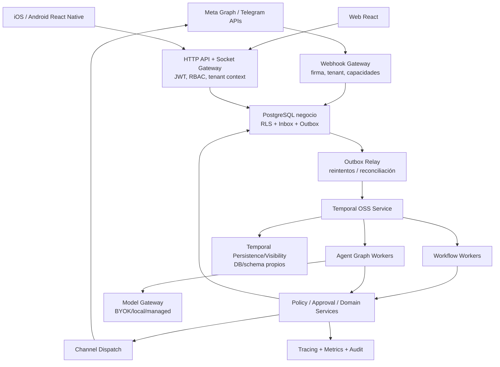

# Whatsap-Automat — Blueprint arquitectónico v0.4

> **Estado:** especificación de diseño y plan de implementación, NO código implementado ni pruebas superadas.  
> **Baseline verificado:** `glender222/whatsap-automat`, `main` en `20d16219af37f7203f93d89ec5211f5658d8fcd0` (2026-10-30).  
> **Procedencia:** inspección estática de GitHub y de la especificación v0.3; documentación oficial de Temporal, PostgreSQL, Telegram y Expo.  
> **Objetivo:** sistema **automation-first**, abierto bajo **MIT** (decisión de licencia; cambio legal/técnico aún no aplicado), multiempresa, self-hosted completo y cloud administrado, para empresas y desarrolladores.  
> **Fuera de esta entrega:** modificar el repositorio, ejecutar test suites, probar conectividad real o certificar seguridad de producción.

## Índice

1. Registro de decisiones y alcance
2. Auditoría de evidencias y brechas
3. Arquitectura lógica, despliegue y flujos
4. ADRs 0001–0017
5. Contratos canónicos y APIs
6. Modelo de datos, migraciones y Row-Level Security
7. Temporal: orquestación duradera e integración transaccional
8. Harness de grafo libre, modelos, memoria y políticas
9. Omnicanal e identidad por canal
10. Arquitectura de carpetas y evolución sin reescritura
11. UX/UI web y aplicaciones móviles
12. Seguridad, privacidad y observabilidad
13. QA: gates, escenarios adversariales y criterios de salida
14. Roadmap detallado por PR, dependencias y rollback
15. Open source MIT, self-hosted y operación
16. Riesgos, supuestos y decisiones técnicas pendientes
17. Fuentes y trazabilidad

---

## 1. Registro de decisiones y alcance

### 1.1 Decisiones **tomadas por el propietario del proyecto** (no reabrir)

| ID | Decisión vinculante | Implicación |
|---|---|---|
| D-01 | Automation-first | Automatizaciones, workflow, APIs, IA y operaciones son núcleo; CRM/embudo son módulos. |
| D-02 | Empresas y desarrolladores | UX guiada + SDK/API/diagnóstico avanzado. |
| D-03 | WhatsApp Meta Cloud API, Instagram, Messenger, Telegram | Cuatro adaptadores con capacidades diferentes; integración alternativa de WhatsApp opcional y aislada. |
| D-04 | Agentes: modo visual y modo avanzado | Dos vistas del **mismo grafo versionado**, no motores divergentes. |
| D-05 | Agentes + automatizaciones desde lanzamiento | Se construyen dos motores coordinados, no dos productos. |
| D-06 | Self-hosted completo y servicio cloud | Núcleo funcional sin servicios privativos forzosos. |
| D-07 | MIT | Archivo LICENSE, notices, compatibilidad de dependencias y metadatos correctos. |
| D-08 | Grafo visual de agentes con delegación avanzada | Enrutamiento y composición flexible. |
| D-09 | BYOK, modelos locales, proveedor administrado | Abstracción LLM y secretos por empresa. |
| D-10 | Historial, resumen y memoria estructurada | Controles de retención, evidencia, consentimiento y segregación. |
| D-11 | Workflows: plantillas, asistente y reglas al inicio; canvas después | Evitar que el motor dependa de una futura UI. |
| D-12 | Autonomía según riesgo con aprobaciones | Policy Engine central y revalidación en la ejecución. |
| D-13 | Workspace unificado | Inbox, automatizaciones, agentes y operaciones conectados. |
| D-14 | Gates estrictos de seguridad, E2E, integración, IA y regresión | No publicar stable sin evidencia. |
| D-15 | Orquestador especializado de workflows | Reemplazar cadenas asíncronas frágiles por ejecución duradera. |
| D-16 | PostgreSQL compartido + tenant_id + RLS | RLS activado y FORCED en tablas de negocio, sesiones transaccionales seguras. |
| D-17 | Identidad independiente por canal | Prohibido fusionar identidades entre canales automáticamente, incluso mediante IA. |
| D-18 | Grafo altamente libre | Ciclos/delegación/ramas permitidos, sujetos a presupuestos/seguridad. |
| D-19 | Web y apps móviles nativas | Android e iOS como clientes instalables, no WebView. |
| D-20 | Meta onboarding guiado inicial; embedded cuando aprobado | Fases con dependencias externas explícitas. |

### 1.2 Recomendaciones técnicas **propuestas, no elecciones expresas del usuario**

- **Temporal OSS + TypeScript SDK** para motor de ejecución especializada. Temporal Cloud opcional solo para despliegues gestionados; autoalojamiento igualmente completo.
- **React Native + Expo development builds** como forma de entregar clientes Android/iOS con componentes nativos y contratos API compartidos. **Supuesto a confirmar:** “nativa” significa app instalable con UX y APIs nativas; si exige Swift/Kotlin por separado, deberá sustituirse este ADR.
- **Monolito modular** Node/TypeScript/Express actual + procesos dedicados de Workers Temporal; PostgreSQL negocio separado de las bases/schema de persistencia Temporal.
- **OpenAPI 3.1, JSON Schema/TypeScript** para contratos, **Socket.IO** para web y transporte móvil opcional con sincronización REST de verdad; **Expo SecureStore** para credenciales de sesión móviles.
- **Aislamiento dentro de Temporal:** namespace por entorno; autorización por tenant y task-queues/quotas como aislamiento operacional. No asumir que un namespace de Temporal sustituye a RLS.
- Mantener `company_id` físico donde ya existe, usando `tenantId` en contratos; no renombrar cientos de columnas innecesariamente.

### 1.3 Estados de certeza

- **HECHO:** visible en código GitHub del commit fijado.
- **RIESGO:** consecuencia plausible todavía no demostrada mediante exploit o prueba de integración.
- **DECISIÓN:** requisito confirmado por el usuario.
- **PROPUESTA:** opción recomendada pendiente de implementación y spike/benchmark.
- **GATE:** prueba reproducible obligatoria antes de liberar.

## 2. Auditoría de evidencias y brechas

### 2.1 Inventario comprobado

| ID | Evidencia (ruta relativa al repositorio) | Hallazgo y consecuencia |
|---|---|---|
| EV-01 | `WhatsaapWeb-JS/src/app.ts` | Rutas mixtas modernas/legacy; `/api/chats`, `/api/whatsapp`, `/api/media` se montan con `optionalWhatsappJwt`. |
| EV-02 | `WhatsaapWeb-JS/src/middleware/jwtAuth.ts` | `optionalWhatsappJwt` puede admitir peticiones con default company si el flag desactiva JWT. Riesgo P0 condicionado a entorno. |
| EV-03 | `WhatsaapWeb-JS/src/sockets/socketHandler.js` | `socket.on("join", chatId)` une room directamente; `logout` invoca `whatsappService.logout()` sin resolución tenant visible. Riesgo P0. |
| EV-04 | `WhatsaapWeb-JS/src/sockets/socketEmitter.ts` | `emitDashboard` difunde con `ioInstance.emit`. Riesgo P0 de cross-tenant. |
| EV-05 | `WhatsaapWeb-JS/src/services/whatsappService.ts` | `handleMetaWebhook` persiste y luego aguarda la ejecución de IA dentro del handler HTTP; pausa usa `.catch(() => false)` en `maybeAutoReplyWithAgent`. |
| EV-06 | `WhatsaapWeb-JS/src/routes/metaWebhookRoutes.ts` | HMAC contra raw body cuando provider `meta-cloud`; requiere Meta app secret en ese modo. |
| EV-07 | `WhatsaapWeb-JS/src/services/whatsapp/meta/MetaAccountStore.ts` | Asociación de `phone_number_id` a empresa; cifrado de credencial disponible; índice único global para número activo (migración 004). |
| EV-08 | `WhatsaapWeb-JS/src/services/whatsapp/meta/MetaInboxStore.ts` | Webhook inbound deduplicado y guardado dentro de transacción PostgreSQL. No implica recuperación duradera de IA posterior. |
| EV-09 | `WhatsaapWeb-JS/src/modules/ai/application/AiRuntimeOrchestrator.ts` | Router → sesión → loop → resultado; habilitado para refactor incremental. |
| EV-10 | `WhatsaapWeb-JS/src/modules/ai/application/AgentToolRuntimeLoop.ts` + `domain/tool.types.ts` | `MAX_TOOL_ROUNDS = 4`, `MAX_TOOL_CALLS_PER_MESSAGE = 8`, interpretación estructurada de respuesta del modelo. |
| EV-11 | `WhatsaapWeb-JS/src/modules/ai/application/AgentToolExecutor.ts` | Validaciones de modo, módulo y tool; sandbox test para write/send. No asumir cobertura total del nuevo modelo de riesgo. |
| EV-12 | `WhatsaapWeb-JS/src/db/migrations/021_ai_chat_sessions.sql` | `ai_chat_sessions`, `ai_session_turns`, `ai_session_events`; mantener y extender, no duplicar. |
| EV-13 | `WhatsaapWeb-JS/src/db/migrations/000_create_operational_core.sql` | `contacts`, `conversations`, `messages` con `company_id`; restricciones históricas no incluyen ID de conexión. |
| EV-14 | `WhatsaapWeb-JS/src/db/migrations/003_add_user_company_scope.sql` | Asignación legacy de `company_id=1`; requiere revisión para migración real multiempresa. |
| EV-15 | `WhatsaapWeb-JS/src/core/application/ports/messageChannel.port.ts` | Puerto existente con envío, descarga de medios, leído, status; preservar y evolucionar. |
| EV-16 | `WhatsaapWeb-JS/src/modules/ai/infra/provider/AiProviderFactory.ts` | Fábrica actual admite `opencode` y `openai`; propuesta BYOK/local/managed amplía proveedor y resolución de claves por tenant. |
| EV-17 | `Frontend_py_whatsaapweb/src/routes/AppRoutes.tsx` | Frontend ya contiene Inbox, dashboard, agentes, prueba, pagos, handoff, inventario. |
| EV-18 | `Frontend_py_whatsaapweb/src/factures/agentes/pages/AgentsPage.tsx` | Página de agentes extensa (~1535 líneas), con numerosos estados; candidata a extracción por componentes/casos de uso. |
| EV-19 | `Frontend_py_whatsaapweb/src/factures/setting/components/WhatsAppConnectionSection.tsx` y `hooks/useWhatsAppConnection.ts` | Meta manual coexiste con QR y eventos legacy; diseñar onboarding por proveedor/capacidad. |
| EV-20 | `WhatsaapWeb-JS/package.json`, árbol Git | `license: ISC`, frente a objetivo MIT; no se encontró LICENSE en las 763 entradas del árbol. |
| EV-21 | Árbol Git de 763 entradas | No se detectaron Dockerfile/compose ni `.github/workflows` en esta revisión. |
| EV-22 | `WhatsaapWeb-JS/src/test/meta-webhook-p0.test.ts` | Pruebas automatizadas de firma, tenant desconocido y deduplicación existentes; **no ejecutadas**. |

**Precisión:** no se ha inspeccionado cada línea de los 763 elementos ni confirmado que el servidor productivo use los flags observados. Ausencia en archivos inspeccionados ≠ inexistencia absoluta. No se ejecutaron builds, bases de datos, pruebas, tráfico real, escaneo de credenciales o test de rendimiento.

### 2.2 Brechas clasificadas

- **P0/seguridad:** autorización del handshake y de cada room; emisión limitada a empresa; rutas privadas fail-closed; desconexión por tenant y auditoría de logout; evitar fugas en media y uploads; RLS y compatibilidad legacy.
- **P0/confiabilidad:** webhook HTTP debe confirmar solo persistencia durable; insertar evento/outbox transaccional; recuperación cuando worker cae entre inbound e IA; handoff/pausa falla segura.
- **P1/datos:** `channel_connection_id` en conversación y dedupe; coexistencia de números/cuentas por canal; revisar tabla y FK para impedir referencias cruzadas entre tenants.
- **P1/harness:** ejecuciones/versiones de grafos, approvals, tool grants, presupuestos, sandbox, recuperabilidad.
- **P1/frontend:** navegación unificada y componentes desacoplados; QA de cada acción y de roles, no solo estética.
- **P1/infra:** Temporal, Docker, CI, backups, migraciones.
- **P2/omnicanal:** Instagram/Messenger aprobaciones de Meta, Telegram; tests contractuales por conexión.
- **P2/móvil:** repositorio/apps nativas, secure auth, notificaciones y degradación de conectividad.
- **P2/producto:** configurador de reglas, auditoría, analítica y SDK para developers.

## 3. Arquitectura objetivo y despliegue

### 3.1 Diagrama de contenedores



**Regla de frontera:** el almacén de negocio es la fuente de verdad de mensajes, decisiones y estado de usuario; Temporal es la fuente de verdad para la ejecución durable de workflows. Los estados se correlacionan, pero no se equiparan.

### 3.2 Servicios operativos

| Proceso | Compromiso de producción | Persistencia y aislamiento |
|---|---|---|
| `api` | Auth, REST, WebSocket, autorización, comandos | PostgreSQL negocio con RLS por transacción |
| `webhook-gateway` | Firma, identificación conexión, ingestión durable, respuesta rápida | PostgreSQL negocio, rol muy limitado |
| `outbox-relay` | Publica solicitudes durables de inicio a Temporal | PostgreSQL outbox, idempotencia por workflowId |
| `temporal-server` | Coordinación, timers, reintentos, history, signals | Persistence/Visibility propios; securizar como DB |
| `workflow-worker` | Plantillas, condiciones, waits, actividades de negocio | Client UoW con tenant y límites |
| `agent-worker` | Motor de grafos, proveedores, tools y checkpoints | Client UoW con tenant y límites |
| `dispatch-worker` | Envío externo, reconciliación y estados | Outbox/DB + proveedor, control anti-repetición |
| `web` | Operación desktop y responsive | No credenciales externas |
| `mobile` | iOS/Android, Inbox, approvals y operaciones prioritarias | Sesión segura; caché mínima |
| `otel/metrics` | Métricas y correlación sin payloads PII por defecto | Configurable; optional self-host |
| `postgres` | Datos tenant RLS, audit, events | Backup/PITR y migraciones |

**Dev local:** Temporal CLI `start-dev` sin servicios adicionales; Docker Compose perfil de demostración. **Producción self-hosted:** Temporal Service real, TLS/mTLS, persistencia independiente (Postgres soportado), backups, workers escalables; no usar servidor CLI de desarrollo como prod. Temporal PostgreSQL Visibility posible; no obligar Elasticsearch para primer despliegue. Fuentes al final.

### 3.3 Flujo inbound duradero

1. Canal externo -> webhook, verifica firma/secret usando `channel_connection_id` resuelto solo desde fuente autenticada.
2. Normaliza evento y crea en **una transacción**: `channel_event` deduplicado, mensaje y `processing_outbox` con `effect_key` estable; commit.
3. Responde 2xx tras commit durable, sin esperar al LLM.
4. Relay despacha `startWorkflow` con `workflowId` estable; si falla después de Temporal y antes de confirmar DB, reintento identifica ejecución existente.
5. Workflow obtiene tenant/contexto mínimo y decide `workflow` determinista o `agent graph`.
6. Antes de tools y salida se valida estado de conversación, versión, permisos, pausa/handoff.
7. Efectos de dominio se guardan transaccionalmente; mensajes salientes se guardan como intentos en outbox.
8. Dispatcher verifica límites por canal, permiso y vigencia, envía y reconcilia ACK/status.
9. Telemetría correlaciona `eventId -> workflowId -> agentRunId -> toolCallId -> outboundId`.

**Fallo sensible:** si el proveedor recibe un mensaje pero se pierde el ACK, no se puede garantizar exactamente un envío físico si la API no expone idempotencia. Marcar como `unknown_delivery` y reconciliar/pedir intervención según riesgo; nunca reintentar ciegamente una acción irreversible.

### 3.4 Flujo outbound humano/móvil

`POST command` con `Idempotency-Key` -> validar RBAC/tenant y versión conversación -> `message_intent` + outbox -> dispatcher -> status provider -> timeline. Optimistic UI con id temporal hasta ACK; REST consulta historial y Socket.IO solo notifica deltas autorizados.

### 3.5 Tradeoffs explícitos

- Temporal aporta recuperación pero también un servicio de alta disponibilidad, mantenimiento, upgrades y límites de historial. Un spike debe comprobar memoria/costo de un stack self-host para equipos pequeños.
- El grafo altamente libre exige límites duros por ejecución, costo, TTL y paralelismo; sin esto una ruta cíclica puede agotar dinero/recursos.
- RLS compartida reduce costos pero hace críticas las transacciones y el manejo de conexiones del pool.
- Apps móviles nativas aumentan matriz de pruebas, pipelines y mantenimiento por versión.

## 4. ADRs — Architecture Decision Records

El estado `ACEPTADO` significa **decisión de alcance del usuario**; `PROPUESTO` significa elección de tecnología/implementación sometida a spike y revisión. Se conservan alternativas y consecuencias para evitar decisiones tácitas.

### ADR-0001 — Monolito modular + workers [PROPUESTO]
**Contexto:** base Node/Express/TS ya existente; múltiples servicios externos y clientes.  
**Decisión:** conservar backend, separar `api`, `webhook`, `worker` por proceso; extraer módulos, no reescribir en microservicios.  
**Alternativas:** microservicios ahora; reconstrucción desde cero.  
**Consecuencias:** menor costo de migración y más contratos internos exigibles.  
**Gate:** modo legacy sin ruptura y nuevos endpoints contract-tested.

### ADR-0002 — Temporal como orquestador [PROPUESTO]
**Contexto:** usuario exige orquestación especializada; webhooks y agents deben sobrevivir a caídas.  
**Decisión:** Temporal OSS/TS para workflows, tareas duraderas, timers, signals y aprobación. `Activities` para I/O; `Workflows` deterministas.  
**Alternativas:** Hatchet/Inngest/self-managed BullMQ (no decidido), cola PostgreSQL sencilla.  
**Consecuencias:** mejor modelo de ejecución durable; coste adicional del servicio Temporal y de su DB.  
**Gate:** spike con 1.000 ejecuciones sintéticas, worker kill, retry, replay, versioning, cancelación, restauración y perfil de recursos; umbral por definir en hardware objetivo.

### ADR-0003 — Base compartida + RLS [ACEPTADO]
**Decisión:** `company_id` existente como tenant físico; privilegios SQL separados; `ENABLE/FORCE ROW LEVEL SECURITY` y políticas `USING/WITH CHECK`, RLS tenant-context por transacción; authorization en capa app.  
**Consecuencias:** toda lectura/escritura debe ejecutarse con contexto tenant; queries antiguas `pool.query` requieren migración.  
**Gate:** tests multi-tenant adversariales y consulta sin contexto denegada.

### ADR-0004 — Identidades independientes [ACEPTADO]
**Decisión:** `channel_identity` estable por conexión/canal; sin auto-vinculación de contactos entre canales ni cross-channel memory.  
**Consecuencias:** puede haber dos registros de la misma persona; se prefiere privacidad/certeza a unificación.  
**Gate:** números/handles coincidentes no producen merge ni historial cruzado.

### ADR-0005 — Grafo libre controlado [ACEPTADO con controles obligatorios]
**Decisión:** grafo de agentes permite loops, delegación, fan-out, conditional edge, subgraphs y joins.  
**Alternativas:** DAG estricto (rechazado como limitación funcional).  
**Invariantes:** no ejecución infinita, revalidar tool permissions, límites de presupuesto/paralelismo/hops/duración, auditoría y cancelación.  
**Gate:** test de ciclo sin salida termina por presupuesto y no compromete otros tenants.

### ADR-0006 — Motor de workflows separado del harness [ACEPTADO por diseño]
**Decisión:** triggers/reglas/timers en Workflow Engine; inferencia, delegación y tool selection en Agent Graph Runtime.  
**Gate:** una automatización determinista de saludo/espera no invoca LLM.

### ADR-0007 — Channel Connection Registry [PROPUESTO]
**Decisión:** adaptadores por conexión, no `WHATSAPP_PROVIDER` global; capacidades y credenciales asociadas a tenant/account.  
**Gate:** dos empresas con distinto proveedor/credencial operan en paralelo sin mezcla.

### ADR-0008 — Inbox/outbox + idempotencia por efecto [PROPUESTO]
**Decisión:** commit de inbound y intención de procesamiento juntos; claves únicas por conexión+evento y tenant+effect; no prometer exactamente-once físico.  
**Gate:** crash después de DB commit no pierde IA; duplicado no crea segundo efecto de negocio.

### ADR-0009 — BYOK / local / managed [ACEPTADO]
**Decisión:** `ModelGateway` resuelve credenciales y políticas por tenant; OpenAI/OpenCode actuales se adaptan; implementar un endpoint OpenAI-compatible local solo con network egress controlado.  
**Gate:** proveedor alternativo y fallo tolerado sin fuga de secretos.

### ADR-0010 — Memoria privada y basada en evidencias [ACEPTADO]
**Decisión:** separa historial, resumen de conversación y hechos estructurados con `sourceMessageId`, expiry, consentimiento y revisión/eliminación.  
**Gate:** no memory cross-tenant/cross-channel; borrado elimina derivados y referencias.

### ADR-0011 — Políticas por riesgo y aprobación duradera [ACEPTADO]
**Decisión:** clasificación `read/low-write/medium/high/external-send`; Policy Engine firma autorización contextual para cada efecto. Aprobación humana revalidada tras espera.  
**Gate:** escalada de privilegios vía prompt/documento rechazada; expiry/reject no ejecuta acción.

### ADR-0012 — Experiencia web unificada [ACEPTADO]
**Decisión:** workspace único, inbox operativo, Agent Studio visual/avanzado, wizard de workflows, operaciones y canales.  
**Gate:** pruebas E2E con estados y permisos de cada acción crítica.

### ADR-0013 — Aplicaciones móviles [ACEPTADO alcance; RN/Expo PROPUESTO]
**Decisión:** Android+iOS como apps con pantallas nativas; compartir contratos, validadores y design tokens no JSX de DOM. React Native/Expo como implementación inicial recomendada.  
**Alternativas:** SwiftUI + Jetpack Compose separados si se exige stack nativo estricto.  
**Gate:** builds instalables Android/iOS, pruebas autenticación/push/deep links y casos de Inbox/approvals.

### ADR-0014 — Configuración Meta por fases [ACEPTADO]
**Decisión:** manual guiada/diagnóstico inicialmente, embedded signup solo después de permisos y revisión aplicables.  
**Gate:** no UI de conexión “lista” cuando la app carece de permisos, y no inventar conectividad.

### ADR-0015 — Open source MIT con paridad [ACEPTADO]
**Decisión:** core completo self-hosted; cloud monetiza infraestructura/operación. MIT en archivos correctos tras revisar derechos y licencias de dependencias.  
**Gate:** entorno demo completo sin keys Meta/LLM de pago, LICENSE, NOTICE cuando corresponda, CI reproducible.

### ADR-0016 — Contratos versionados y compatibilidad [PROPUESTO]
**Decisión:** HTTP `/api/v1`, contratos OpenAPI, eventos con schema version, consumers compatibles con versiones soportadas; `v0` rutas existentes con adaptador y fecha de deprecación.  
**Gate:** contract tests web/mobile/API y pruebas de versión anterior soportada.

### ADR-0017 — Observabilidad con privacidad [PROPUESTO]
**Decisión:** OpenTelemetry/OTLP donde tenga sentido, IDs correlacionados; logs estructurados sin contenido de mensajes ni secretos por defecto; auditoría separada, retenida y accesible por tenant.  
**Gate:** obtener traza completa sin exposición de tokens ni mensajes privados en métricas.

## 5. Contratos: tipos y APIs

### 5.1 Paquete compartido versionado (`packages/contracts`)

**Convención:** `tenantId` de los contratos deriva exclusivamente de la sesión/autorización o conexión autenticada. En la persistencia existente se mapea a `company_id`. `connectionId` establece el namespace externo; no basta el número de teléfono.

```ts
// contracts/channel.ts  — diseño ilustrativo, NO archivo implementado.
export type ChannelKind =
  | 'whatsapp-cloud' | 'instagram' | 'messenger' | 'telegram';

export type ChannelCapability =
  | 'text' | 'image' | 'audio' | 'video' | 'document'
  | 'template' | 'interactive' | 'read-receipt' | 'typing';

export interface TenantActor {
  tenantId: string;
  userId: string | null;
  roles: readonly string[];
  requestId: string;
}

export interface ChannelEventV1 {
  schemaVersion: 1;
  eventId: string;                 // internal UUID
  tenantId: string;                // resolved server-side
  connectionId: string;            // internal connection UUID
  channel: ChannelKind;
  externalEventId: string;         // unique within connection
  externalConversationId: string;
  externalIdentityId: string | null;
  eventType: 'message.received' | 'message.status'
           | 'interaction.received' | 'connection.status';
  occurredAt: string;             // provider clock
  receivedAt: string;             // server clock
  correlationId: string;
  payloadRef: string;             // tenant-authorized DB/object reference
}

export interface SendMessageCommandV1 {
  schemaVersion: 1;
  tenantId: string;                // injected, never trusted from input
  connectionId: string;
  conversationId: string;          // internal, tenant-owned
  effectKey: string;
  message: {
    kind: 'text' | 'media' | 'template' | 'interactive';
    text?: string;
    mediaRef?: string;
    templateId?: string;
    parameters?: Record<string, unknown>;
  };
  expectedConversationVersion: number;
  causedBy: { type: 'human' | 'workflow' | 'agent'; id: string };
}

export type DeliveryState =
  | 'pending' | 'dispatched' | 'provider_accepted' | 'delivered'
  | 'read' | 'failed' | 'unknown_delivery' | 'cancelled';
```

`payloadRef` es una referencia interna: no se autoriza al cliente a recuperar arbitrariamente el payload. Las capacidades dependen de versión, cuenta y condiciones del proveedor; no son una lista estática universal.

### 5.2 Puerto de canal (extensión del actual `MessageChannelPort`)

```ts
export interface ChannelAdapterV1 {
  readonly kind: ChannelKind;
  resolveInboundConnection(
    req: { headers: Record<string, string | undefined>;
           pathKey: string | null; rawBody: Uint8Array }
  ): Promise<{ connectionId: string; tenantId: string } | null>;

  verifyInbound(
    connectionId: string, rawBody: Uint8Array,
    headers: Record<string, string | undefined>
  ): Promise<boolean>;

  normalizeInbound(
    connectionId: string, raw: unknown
  ): Promise<ChannelEventV1[]>;

  getCapabilities(connectionId: string): Promise<Set<ChannelCapability>>;
  send(cmd: SendMessageCommandV1): Promise<{
    providerMessageId: string | null;
    accepted: boolean;
    rawStatus: string;
  }>;
  health(connectionId: string): Promise<{
    configured: boolean; authorized: boolean;
    lastErrorCode: string | null;
  }>;
}
```

**Transición:** crear un `ChannelAdapterV1` puente sobre el puerto existente; no eliminar el puerto anterior mientras haya importadores. Mensajería, status, media y permisos se amplían como interfaces segregadas si conviene.

### 5.3 Grafo de agentes y workflows

```ts
export type NodeKind =
  | 'agent' | 'router' | 'condition' | 'tool' | 'approval'
  | 'subgraph' | 'parallel' | 'join' | 'handoff' | 'end';

export interface AgentGraphVersionV1 {
  schemaVersion: 1;
  graphId: string;
  version: number;
  tenantId: string;
  entryNodeId: string;
  nodes: Array<{
    id: string; kind: NodeKind;
    config: Record<string, unknown>;
  }>;
  edges: Array<{
    id: string; from: string; to: string;
    condition?: string; priority?: number;
  }>;
  policyRef: string;
  limits: {
    maxSteps: number;
    maxDelegations: number;
    maxParallelNodes: number;
    maxDurationSeconds: number;
    maxModelTokens: number;
    maxCostMicroUsd: number;
  };
  status: 'draft' | 'published' | 'retired';
  specHash: string;
}

export type AgentRunState =
  | 'queued' | 'running' | 'awaiting_approval' | 'waiting'
  | 'handed_off' | 'completed' | 'failed'
  | 'cancelled' | 'budget_exhausted';

export interface ApprovalRequestV1 {
  id: string;
  tenantId: string;
  runId: string;
  nodeId: string;
  effectKey: string;
  proposedActionHash: string;
  policyVersion: number;
  risk: 'low' | 'medium' | 'high';
  status: 'pending' | 'approved' | 'rejected' | 'expired' | 'revoked';
  expiresAt: string;
}
```

**No interpretar** `maxSteps` como límite contra el diseño libre del grafo: es un límite operativo de ejecución, no de forma o ciclos. Valores máximos por plan/tenant se validan en servidor. `specHash` congela la definición publicada; un run nunca cambia dinámicamente a una versión posterior.

### 5.4 Identidades, memoria y permisos

```ts
export interface ChannelIdentityV1 {
  id: string;
  tenantId: string;
  connectionId: string;
  channel: ChannelKind;
  externalUserId: string;
  displayName: string | null;
  // NO globalPersonId en v1
}

export interface MemoryRecordV1 {
  id: string; tenantId: string;
  channelIdentityId: string; // sin mezclas entre proveedores
  kind: 'summary' | 'preference' | 'business_fact';
  valueRef: string;
  sourceMessageId: string | null;
  confidence: number | null;
  consentBasis: string | null;
  expiresAt: string | null;
  verificationState: 'unverified' | 'verified' | 'rejected';
}

export interface ToolInvocationV1 {
  id: string;
  tenantId: string;
  agentRunId: string;
  graphVersion: number;
  toolName: string;
  schemaVersion: number;
  input: Record<string, unknown>; // validate via schema at runtime
  effectKey: string;
  expectedConversationVersion: number;
  requestedByNodeId: string;
}
```

No usar confianza del LLM como autorización. Herramientas de lectura y escritura deben tener contratos de error normalizados (`UNAUTHORIZED`, `POLICY_DENIED`, `APPROVAL_REQUIRED`, `CONFLICT`, `RETRYABLE`, `UNKNOWN_DELIVERY`) y auditoría.

### 5.5 Endpoints API versionados (propuesta)

| Método/ruta | Operación | Alcance/Idempotencia |
|---|---|---|
| `GET /api/v1/workspaces/current` | Navegación y permisos | JWT, tenant |
| `GET /api/v1/conversations` | Filtros, paginación cursor | tenant + RBAC |
| `GET /api/v1/conversations/{id}/messages` | Mensajes y estados | tenant + acceso conversacional |
| `POST /api/v1/conversations/{id}/messages` | Envío humano | Idempotency-Key |
| `POST /api/v1/conversations/{id}/takeover` | Handoff/toma de control | CAS `expectedVersion` |
| `POST /api/v1/conversations/{id}/pause-ai` | Pausa IA | CAS, fail-closed |
| `GET /api/v1/channel-connections` | Conexiones y health | tenant + permisos |
| `POST /api/v1/channel-connections/{id}/validate` | Diagnóstico | nunca devuelve secretos |
| `POST /api/v1/agent-graphs` | Crear draft | tenant, `agent:write` |
| `POST /api/v1/agent-graphs/{id}/validate` | Lint, políticas, límites | sin efectos externos |
| `POST /api/v1/agent-graphs/{id}/publish` | Publicar versión inmutable | ETag + gates |
| `POST /api/v1/agent-runs/simulate` | Simulador | sandbox sin write/send |
| `GET /api/v1/agent-runs/{id}/trace` | Timeline redacted | tenant + roles |
| `POST /api/v1/automation-definitions/{id}/publish` | Publicar regla/plantilla | versionado |
| `GET /api/v1/approvals` | Cola | permisos de aprobación |
| `POST /api/v1/approvals/{id}/decision` | Aprobar/rechazar | Idempotency-Key + versión |
| `GET /api/v1/operations/executions` | Ejecuciones y reintentos | permisos de soporte tenant |

**Respuestas:** `ProblemDetails`/errores tipados, `correlationId`, `eventVersion`, cursores; `409 Conflict` en versión obsoleta; `401` sesión inválida, `403/404` recurso ajeno, `422` validación. Todas las rutas privadas son auth-required.

### 5.6 Eventos realtime

```ts
type ServerEventV1 =
  | { type: 'conversation.updated'; tenantId: string;
      conversationId: string; version: number; eventId: string }
  | { type: 'message.created'; tenantId: string;
      conversationId: string; messageId: string; eventId: string }
  | { type: 'agent.run.updated'; tenantId: string;
      runId: string; state: AgentRunState; eventId: string }
  | { type: 'approval.created'; tenantId: string;
      approvalId: string; eventId: string };

type AuthorizedRoom =
  | `tenant:${string}`
  | `conversation:${string}:${string}`
  | `user:${string}:${string}`;
```

Solo el **servidor** resuelve tenant y agrega sockets a rooms. Cliente envía la intención de suscripción a `conversationId`, backend comprueba membresía en cada solicitud. Un ID legado `chatId` jamás debe ser un nombre de room global.

## 6. Modelo de datos y RLS

### 6.1 Mantener datos existentes y añadir lo mínimo

**Reutilizar:** `companies`, `contacts`, `conversations`, `messages`, `message_attachments`, `message_statuses`, `whatsapp_business_accounts`, `whatsapp_webhook_events`, `ai_agents`, `ai_chat_sessions`, `ai_session_turns`, `ai_session_events`, `handoff_tickets`, pedidos y catálogo.

**Expandir:**
- `conversations.channel_connection_id` (nullable al migrar; obligatorio tras backfill validado).
- `contacts.channel_connection_id` y `channel_identity_id` o relación normalizada; **no unificar personas**.
- `messages.channel_connection_id`, `origin_event_id`, `delivery_state`, `client_request_id`, `correlation_id`.
- Índices compuestos `(company_id, channel_connection_id, external_conversation_id)`.
- `conversation_state_version` para CAS/handoff y preservación de orden.

**Nuevas tablas de negocio (plan lógico):**

```
channel_connections(id, company_id, channel, external_account_id,
                    credential_ref, status, capabilities_json, created_at)
channel_identities(id, company_id, channel_connection_id, external_user_id,
                   display_name, metadata_json)
channel_events(id, company_id, channel_connection_id, provider_event_id,
               kind, occurred_at, payload_ref, status)
processing_outbox(id, company_id, effect_key, kind, aggregate_id, payload_ref,
                  status, attempts, lease_until, last_error_code)
workflow_definitions(id, company_id, name, draft_spec, active_version)
workflow_versions(id, company_id, workflow_id, version, spec_json, spec_hash, published_at)
workflow_runs(id, company_id, workflow_version_id, temporal_workflow_id,
              status, correlation_id, created_at, updated_at)
agent_graphs(id, company_id, title, active_version)
agent_graph_versions(id, company_id, graph_id, version, spec_json, spec_hash,
                     policy_version, published_at)
agent_runs(id, company_id, graph_version_id, source_event_id, temporal_workflow_id,
           status, budget_json, cost_micro_usd, created_at, updated_at)
agent_node_executions(id, company_id, agent_run_id, node_id, attempt,
                      effect_key, status, duration_ms, redacted_output_ref)
approval_requests(id, company_id, agent_run_id, effect_key,
                  action_hash, policy_version, status, expires_at, resolved_by)
channel_identity_memory(id, company_id, channel_identity_id, kind,
                        source_message_id, encrypted_value_ref, expires_at,
                        consent_basis, verification_state)
provider_credentials(id, company_id, kind, secret_ref,
                     key_fingerprint, status, rotated_at)
outbound_attempts(id, company_id, outbox_id, provider_request_id,
                  provider_message_id, delivery_state, evidence_ref)
audit_events(id, company_id, actor_id, subject_type, subject_id,
             operation, outcome, redacted_details_json, occurred_at)
```

**Clave:** `UNIQUE (channel_connection_id, provider_event_id)` y `UNIQUE (company_id, effect_key)`; definir claves compuestas o triggers para referencias entre tablas que no compartan el tenant. Las PK de cada tabla no sustituyen comprobaciones de pertenencia.

### 6.2 Migraciones nuevas — secuencia propuesta

> **NO modificar** `000`–`021` ya publicadas. Empezar `022_*` después de inspeccionar su orden real en deploy.

| Migración | Operación | Estrategia compatible |
|---|---|---|
| `022_security_tenant_indexes.sql` | Auditar columnas tenant, índices y constraints compatibles | Prechecks; si hay datos inválidos detener |
| `023_channel_connections.sql` | Registry + identities + eventos | Backfill Meta con mapping verificable |
| `024_processing_outbox.sql` | Outbox y outbound attempts | Activación inicial solo para nuevos eventos |
| `025_agent_graph_runtime.sql` | Grafos, versiones, runs, approvals | Mantener `ai_chat_sessions` vigente |
| `026_workflow_definitions.sql` | Templates, versions, runs | Sin modificar workflow legacy inexistente |
| `027_memory_and_provider_credentials.sql` | Memoria y BYOK | Cifrar/borrado conforme a política |
| `028_tenant_rls_rollout.sql` | RLS por lotes/tabla, roles y políticas | Preparar auditoría, después forzar |
| `029_backfill_connection_scope.sql` | Asignación de conexiones legacy verificadas | No adivinar account ownership |
| `030_constrain_connection_scope.sql` | NOT NULL/uniques finales | Solo después de comparar/backfill |

**Importante:** los nombres y numeración son propuestas de PR; comprobar migraciones posteriores en `main` antes de crear archivos.

### 6.3 Ejemplo de política RLS — ilustrativo

```sql
-- Ejemplo: no ejecutar directamente sobre producción sin migration review.
-- Usar rol de aplicación NO-owner, NO-BYPASSRLS, grants mínimos.
ALTER TABLE conversations ENABLE ROW LEVEL SECURITY;
ALTER TABLE conversations FORCE ROW LEVEL SECURITY;

CREATE POLICY conversation_tenant_isolation ON conversations
FOR ALL
TO app_runtime
USING (
  company_id = NULLIF(current_setting('app.tenant_id', true), '')::integer
)
WITH CHECK (
  company_id = NULLIF(current_setting('app.tenant_id', true), '')::integer
);
```

La política debe extenderse a **todas** las tablas con información tenant (incluidas auditoría, memoria, tokens, adjuntos accesibles mediante joins). Las tablas hijas sin `company_id` necesitan rediseño con tenant físico o política segura por join y FK compuesta. No conceder `TRUNCATE`/DDL al rol runtime. Roles `app_runtime`, `app_webhook`, `app_migration` separados. El rol runtime nunca debe ser superusuario ni tener `BYPASSRLS`; `FORCE` evita el bypass habitual del dueño, pero no el de superusuarios.

**Contexto transaccional obligatorio (TypeScript conceptual):**

```ts
async function withTenantTx<T>(
  pool: Pool, tenantId: number,
  fn: (client: PoolClient) => Promise<T>
): Promise<T> {
  const client = await pool.connect();
  try {
    await client.query('BEGIN');
    await client.query(
      "SELECT set_config('app.tenant_id', $1, true)",
      [String(tenantId)]
    );
    const value = await fn(client);
    await client.query('COMMIT');
    return value;
  } catch (e) {
    await client.query('ROLLBACK');
    throw e;
  } finally {
    client.release();
  }
}
```

**Invariantes:** tenant viene de claims verificados/conexión autenticada; no de `req.body`. El callback usa el mismo `client`; una query con `pool.query` escaparía al contexto de transacción y debería fallar por RLS (no elegir tenant default). Cada checkout de conexión no debe heredar contextos; `set_config(..., true)` es local a transacción. Probar PgBouncer transaction pooling si se usa.

### 6.4 Backfill sin fugas

1. Inventariar `company_id`, relaciones y cuentas Meta por empresa.
2. Insertar `channel_connections` a partir de cuentas cuya pertenencia esté verificada.
3. Mapear conversaciones por canal + identificador externo **solo cuando exista correspondencia no ambigua**.
4. Separar filas ambiguas en reporte administrable, no asignarlas a la empresa 1.
5. Añadir índices nuevos sin sustituir los viejos hasta que frontend/API nuevos estén listos.
6. Activar RLS por módulos con feature flags y read comparison; auditar role matrix.
7. Quitar defaults/fallback de tenant **antes** de exponer multi-tenant.
8. Verificar backups y restauración, retención y borrado por tenant.

## 7. Temporal — implementación duradera

### 7.1 Principio de determinismo

`Workflow` Temporal ejecuta control de flujo determinista (timers, signals, `ChildWorkflow`, cancelación). **No** llama directamente SQL, LLM ni APIs de canales. Toda E/S ocurre en `Activities` con timeouts, retry y dedupe; una misma Activity puede ejecutarse más de una vez.

```ts
// PSEUDOCÓDIGO de contrato, no API final para pegar sin adaptar.
async function conversationWorkflow(eventRef: string) {
  // 1) activity: load verified inbound + tenant (sin payload sensible en history)
  // 2) activity: check pause/handoff/permissions, read scoped context
  // 3) child workflow: deterministic template OR dynamic agent graph
  // 4) activity: apply approved business effect with effectKey
  // 5) activity: enqueue outbound; do not send provider call inside workflow
  // 6) await signals/approval if necessary; cancellation supported
}
```

Definir `workflowId = inbound:{connectionId}:{providerEventId}` (hash seguro/normalizado de IDs externos) para no duplicar start; mismo `id` al reintentar. Inicio desde relay transaccional: `processing_outbox` committed -> start -> mark started. Si se cae entre start y mark, repetición identifica start existente.

### 7.2 Ownership y persistencia

- Temporal Server guarda historial de ejecución; los registros business auditables (`agent_runs`, `workflow_runs`, tool effects) viven en PostgreSQL con RLS.
- `Workflow` debe transportar **referencias cortas** (`eventRef`, `tenantId` resuelto, IDs), no tokens, mensajes enteros ni documentos PII en el historial Temporal.
- En Temporal, `tenantId` es dato de contexto, **no credencial**: cada Activity revalida tenant y autorización antes de tocar DB.
- Separar API DB y DB/schema de Temporal, con roles y backups distintos.
- `taskQueue` por tipo de carga; cuotas y límites por tenant en scheduler/policy, evitar tenant muy pesado bloqueando a otros.
- Configurar workers y service con health, TLS/mTLS, autenticación y permisos; no exponer puerto Temporal a internet.
- Migraciones de definición de workflows exigen versionado compatible con replay y rollout; freezes de definición de grafo para runs existentes.
- Mantener periodos de retención y límites de event history; usar `Continue-As-New` cuando corresponda.

### 7.3 Actividades obligatoriamente idempotentes

| Actividad | Clave | Estrategia |
|---|---|---|
| `persistInbound` | connection + providerEventId | Unique constraint y transacción |
| `createPreorder` | tenant + run + logical-action | Unique `effectKey` y CAS dominio |
| `createHandoff` | tenant + conversation + stateVersion | Upsert y cambio de estado atómico |
| `applyTag` | tenant + identity + tag + cause | Idempotencia compuesta |
| `enqueueMessage` | tenant + logical send effect | Un único intent con provider retry controlado |
| `approveAction` | tenant + approvalId + version | CAS y expiración |
| `writeMemory` | tenant + identity + sourceFact | Upsert + evidencia/TTL |

### 7.4 Registro de fallos y modos degradados

- Temporal no disponible: webhook debe registrar inbound/outbox y devolver 2xx solo después de persistir; relay reintenta; UI muestra `automation_delayed`.
- PostgreSQL no disponible: webhook devuelve error para que proveedor reintente (según proveedor), nunca confirma pérdida silenciosa.
- Proveedor LLM no disponible: fallback configurado, handoff o pausa; no enviar contenido inventado.
- Estado de pausa ilegible: prohibir envío IA; puede alertar y esperar.
- Envío externo ambiguo: marcar `unknown_delivery`; comparar status webhook/provider si disponible; intervención si riesgo.
- Token externo vencido: marcar conexión `needs_reauthorization`; cola retiene o cancela según TTL/política.
- Temporal storage restore: documentar reconciliación entre outbox, executions y datos business.

## 8. Agent Graph Harness de composición libre

### 8.1 Libertades del diseñador

- Ciclos y reentrada condicional, subgrafos reutilizables y delegación a otros agentes.
- Ramas paralelas, joins deterministas, elección de modelos por política y procesamiento de herramientas.
- Memoria contextual según permisos y origen del mensaje.
- Publicar versiones inmutables; pruebas de conversación en modo aislado.

### 8.2 Límites operativos que **no** son opcionales

| Riesgo | Barrera |
|---|---|
| Ciclo infinito/agent ping-pong | `maxSteps`, `maxDelegations`, deadline duradera |
| Explosión de costo | tokens/costo micro-USD por run y cuotas tenant; hard stop |
| Fan-out excesivo | `maxParallelNodes`, semáforos de tenant, backpressure |
| Prompt injection | instrucciones no confiables no otorgan tools; política externa |
| Agente muta sin aprobación | policy risk, approval token vinculado a hash de acción |
| Retry duplica pedido/envío | effectKey + persistencia + reconciliación |
| Cambio de grafo en ejecución | congelar spec/version/hash por run |
| Inyección mediante URL/herramienta | allowlist, validación URL, SSRF bloqueado, egress |
| Falta de respuesta | fallback/handoff seguro, observabilidad |

Límites pueden ser configurables dentro de techo hard impuesto por la plataforma. La libertad de grafo es **composicional**, no ilimitación de recursos.

### 8.3 Compilación y ejecución del grafo

`draft spec -> schema validation -> topology validation -> policy static checks -> dry-run suite -> immutable publish -> execution`.

Compilador acepta ciclos, pero detecta: nodos sin salida y no intencionales, referencias faltantes, joins ambiguos, rutas hacia tools sin permisos, conditions no soportadas, subgraphs recursivos no controlados, escalamiento de privilegios y loops sin budgets. Errores con ubicación visual por nodo/arista.

El scheduler del grafo escoge el siguiente nodo desde estado versionado, persiste checkpoints en servicios business y coordina tareas por Temporal. No ejecutar código JavaScript arbitrario aportado por el tenant en el proceso API/worker principal; opciones futuras de extensión mediante conectores con sandbox, firma y permisos.

### 8.4 Políticas por riesgo / approvals

**Matriz orientativa** (ajustable con máximos no eludibles):

| Clase | Ejemplos | Comportamiento inicial |
|---|---|---|
| `read` | Catalog search, order lookup autorizado | Sin aprobación, audit |
| `low_write` | Etiqueta interna reversible | Permiso explícito + audit |
| `medium_write` | Crear prepedido, modificar estado comercial | Herramienta validada + reglas tenant + idempotencia |
| `high_write` | Cambiar cobro, reembolsar, alterar stock reservado | Aprobación humana/RBAC, controles de dominio |
| `external_send` | Enviar por canales | Ventana/política, permiso, status y CAS antes de dispatch |
| `admin` | Secretos, publicar agente, conectar canales | MFA o reautenticación según riesgo, RBAC administrador |

Un `approve` no permite ejecución indefinida: aprobar **hash de acción + argumentos + actor + tenant + versión de política**; revalidación al consumir. Dos operadores que aprueben simultáneamente no deben duplicar efectos. Rechazo/caducidad cancela.

### 8.5 BYOK, local y managed

- Credenciales por tenant, cifrado AES-GCM o vault compatible, rotación y mascarado; separar permisos de uso de permisos de administración.
- Providers por adaptador: `createCompletion`, `stream`, `embeddings?`, `capabilities`, `usage`, `cancel`, `health`; selector según política, latencia y costo, sin fallback silencioso a proveedor externo cuando datos están restringidos a local.
- Modelos locales: endpoint configurado por administrador de instancia/tenant, bloquear loopback/metadata/private networks excepto destinos explícitamente autorizados y segmentados; SSRF defensivo.
- Managed: cuentas/credenciales administradas de plataforma con ledger de uso por tenant, límites y pricing configurable; no claim de facturación listo.
- Agente puede elegir modelo por ruta si política lo permite; registrar modelo/version tokens, duración y costo estimado vs confirmado.

### 8.6 Memoria y privacidad

Contexto: `recent messages -> deterministic summarizer -> structured facts -> authorized retrieval`. Memoria `channel_identity_id` específica; no mezclar Telegram y WhatsApp. Cada hecho con evidencia (mensaje), fecha, confidence, consentimiento/retención. No usar historial sensible completo como default en tool traces o Temporal history. Borrado debe propagarse a resúmenes/embeddings/caches/logs sensibles según política y obligaciones aplicables.

## 9. Omnicanal y conexión

### 9.1 Matriz capability-driven

| Propiedad | WhatsApp Cloud | Instagram | Messenger | Telegram |
|---|---|---|---|---|
| Identidad externa | WA ID + phone-number account | Usuario de Instagram dentro de conexión autorizada | PSID/contexto página | Bot + chat/user ID |
| Conexión | App Meta / WABA + phone number | Cuenta profesional + permisos aplicables | Página + permisos aplicables | Bot token + webhook secret |
| Entrada | Webhook verificado | Webhook verificado | Webhook verificado | Webhook secret/token |
| Salida | Ventana, plantillas y tipos permitidos | Restricciones Meta por producto | Restricciones Meta por producto | Bot API y reglas Telegram |
| Dedupe | ID evento/mensaje + conexión | Evento/mensaje + conexión | Evento/mensaje + conexión | `update_id` + bot/conexión |
| Media | APIs Meta y referencias | Tipos/capacidades de la conexión | Tipos/capacidades de la página | `file_id`/Bot API |
| Estado de disponibilidad | Health + credenciales + permisos | Health + permisos/account | Health + permisos/page | Webhook info + bot |

**No asumir** equivalencia de “typing”, read receipts, botones, plantillas, mensajes proactivos o limites. Guardar `capabilitiesVersion` por conexión y capacidades efectivas. Revisar requisitos Meta en implementación porque permisos/revisión pueden variar según producto y configuración.

### 9.2 Onboarding (primera versión)

1. Elegir tipo de canal.
2. Mostrar requisitos previos y permisos antes de pedir credenciales.
3. Capturar secretos por backend HTTPS, enmascarados y cifrados; no imprimir ni devolver valores.
4. Verificación controlada (sin afirmar conectado por guardar formulario).
5. Detectar configuración webhook, suscripción y scopes.
6. Mensaje de prueba autorizado y estado real.
7. Activar triggers solo cuando la conexión esté apta.
8. Diagnóstico, renovación, rotación y desconexión con consecuencias explícitas.

**Meta embedded:** feature-gated; pasar por revisión/aprobación, flujo de tokens y pruebas de revocación antes de habilitar. Ruta manual nunca debe depender de herramientas tipo Burp/captura de cookies.

**Telegram:** el secreto del webhook se verifica como lo especifica la Bot API; `update_id` es dedupe por bot. Modo polling solo para desarrollo y no simultáneo con webhook activo.

### 9.3 Estado de identidad

`channel_identity` = identidad local de usuario externo por conexión; un mismo nombre/phone/handle en distintos canales **no** comparte historial ni memoria. UI permite buscar globalmente por canal, pero no afirmar identidad común.

## 10. Arquitectura de carpetas y estrategia de evolución

### 10.1 Estado real que se preserva

- Backend: `WhatsaapWeb-JS/src/` con `core/`, `modules/`, `routes/`, `services/`, `sockets/`, `db/migrations/`.
- Frontend: `Frontend_py_whatsaapweb/src/factures/`, `shared/`, `jotai/`, `routes/`, `utils/socket.ts`.
- Migrations 000–021 y su `Migrator.ts`.
- Herramientas, sesiones, handoff, servicios Meta y tests actuales como base a mantener.
- Instrucciones del repositorio: `AGENTS.md` exige cambio mínimo, typecheck/build/tests y lectura de reglas locales.

### 10.2 Árbol objetivo **propuesto**, incremental

```text
whatsap-automat/
├─ LICENSE                          # MIT, tras verificación de derechos
├─ README.md
├─ CONTRIBUTING.md
├─ SECURITY.md
├─ CODE_OF_CONDUCT.md
├─ .github/
│  ├─ workflows/ci.yml
│  ├─ workflows/release.yml
│  └─ ISSUE_TEMPLATE/
├─ docs/
│  ├─ architecture/
│  │  ├─ BLUEPRINT_v0.4.md
│  │  ├─ diagrams/
│  │  └─ ADR/
│  │     ├─ 0001-modular-workers.md
│  │     ├─ 0002-temporal.md
│  │     ├─ 0003-rls.md
│  │     └─ ... 0017 ...
│  ├─ api/openapi.yaml
│  ├─ security/tenant-threat-model.md
│  ├─ qa/test-matrix.md
│  ├─ runbooks/
│  └─ implementation/pr-roadmap.md
├─ packages/                        # NUEVOS; no mover todo inmediatamente
│  ├─ contracts/
│  │  └─ src/{channels,conversations,agents,workflows,approvals,errors}/
│  ├─ design-tokens/
│  ├─ sdk-ts/
│  └─ test-fixtures/
├─ apps/
│  └─ mobile/                        # React Native/Expo propuesto
│     ├─ app/
│     ├─ src/{features,api,auth,ui,notifications,storage}/
│     ├─ android/
│     └─ ios/
├─ WhatsaapWeb-JS/                   # conservar directorio real
│  ├─ src/
│  │  ├─ app.ts
│  │  ├─ middleware/
│  │  ├─ core/
│  │  ├─ db/{Migrator.ts,migrations/}
│  │  ├─ modules/
│  │  │  ├─ tenants/{domain,application,infra,presentation}/
│  │  │  ├─ channels/{domain,application,adapters,infra}/
│  │  │  ├─ conversations/{domain,application,infra,presentation}/
│  │  │  ├─ automations/{domain,application,infra,presentation}/
│  │  │  ├─ ai/{application,domain,infra}/    # extender, NO reemplazar
│  │  │  ├─ approvals/{domain,application,infra,presentation}/
│  │  │  ├─ identity/{domain,application,infra}/
│  │  │  └─ observability/
│  │  ├─ workers/
│  │  │  ├─ temporal/{workflows,activities,signals}/
│  │  │  ├─ agent-graph/{compiler,scheduler,nodes}/
│  │  │  └─ outbox/
│  │  └─ test/
│  └─ scripts/
├─ Frontend_py_whatsaapweb/
│  └─ src/
│     ├─ factures/                   # conservar ruta hasta migración por PR
│     ├─ shared/
│     ├─ features/                   # NUEVAS piezas, sin big-bang rename
│     │  ├─ workspace/
│     │  ├─ inbox/
│     │  ├─ agent-studio/
│     │  ├─ automations/
│     │  ├─ approvals/
│     │  ├─ channels/
│     │  └─ operations/
│     ├─ ui/{components,tokens,a11y}/
│     ├─ routes/
│     └─ utils/socket.ts
└─ deploy/
   ├─ compose.demo.yaml
   ├─ compose.production.example.yaml
   ├─ temporal/
   ├─ postgres/
   └─ backups/
```

**NOTA:** conservar exactamente el directorio real **`WhatsaapWeb-JS`**. No mover archivos masivamente; construir módulos nuevos junto a los existentes.

### 10.3 Reglas de dependencia de módulos

`presentation -> application -> domain <- infrastructure` con composición en bootstrap; channel adapters no importan agentes, agente no conoce Graph API/Telegram, workflow no importa React, mobile no importa Node/PG ni secretos. Contexto tenant obligatorio via `TenantScopedUoW`. Evitar circular dependencies y singleton provider con credenciales globales cuando sea por tenant.

### 10.4 Retiro gradual de legacy

- `/api/chats` y `/api/whatsapp` actuales se adaptan a `v1` sin duplicar estado.
- `WhatsAppService` funciona como fachada temporal; migrar cada call-site a puerto de canal con tests.
- `whatsapp-web.js` queda aislado como adaptador opcional claramente etiquetado, con riesgos, no baseline de producción.
- Se mantiene carpeta `factures` hasta que tests/imports permitan mover componentes.
- Deprecación después de dos releases compatibles definidas y documentadas, no arbitraria.

## 11. UX/UI web y móvil — especificación

### 11.1 Navegación web

**Shell:** sidebar Inbox, Automatizaciones, Agent Studio, Aprobaciones, Contactos, Operaciones, Canales, Analytics, Configuración. Tenant selector solo para usuarios autorizados. Command palette y filtros guardados (posterior).

**Inbox (3 paneles desktop, 1 pantalla + navegación móvil):**
- Izquierda: búsqueda, filtros canal/conexión/estado/equipo/SLA, unread y SLA; paginación cursor y virtualización.
- Centro: timeline (agente/humano/inbound, estado), composer con capacidades del canal, archivos, plantillas, previsualización.
- Derecha: identidad independiente por canal, contexto permitido, actividad del agente, acciones handoff, pedidos, tags.
- Funciones exactas: enviar, reintentar con riesgo, editar borrador, adjuntar, asignar, tomar/liberar, pausar/reanudar, registrar nota, marcar leído, abrir traza. Todo control tiene loading, permission, failure, stale-state, success accesible.
- Seguridad: envío revalida `conversation_state_version`, tenant y capability. Si humano toma conversación, salida IA anterior se invalida.

**Agent Studio:**
- Lista: estado, última evaluación, versión publicada, coste/cap, filtros.
- Editor **gráfico de agentes desde lanzamiento**: nodos/edges, zoom, mini-map, inspector de inputs/outputs, tool grants, loops visibles, visualización de hitos y costos.
- Editor avanzado: YAML/JSON/TypeScript declarativo para usuarios técnicos sobre el mismo schema; no ejecutar código arbitrario.
- Barra persistente: Validar, Simular, Comparar, Publicar, Revertir. Publicar con diff/impact y permisos.
- Trazas node-by-node redactadas, fallos situados en nodo/arista, prompts versionados.
- Limpiar componente `AgentsPage.tsx` gigante en dominios, hooks y vistas, por PR sin cambiar comportamiento al principio.

**Automatizaciones:**
- Galería de plantillas (respuesta fuera de horario, asignación, seguimiento permitido, postventa, handoff).
- Wizard: disparador -> condiciones -> acciones -> espera -> publicación; mostrar resumen en lenguaje natural de lo que ocurrirá.
- Dry-run con eventos sintéticos y reporte `simulatedActions`; historial ejecuciones, pausa, duplicar, rollback.
- Canvas genérico de workflows **no forma parte del alcance de primera versión**, pero schema ya permite renderizarlo en release posterior.

**Aprobaciones/Operaciones:**
- Cola con `risk`, resumen del cambio, contenido afectado, tenant, canal, expiry, policy version.
- Aprobar/rechazar requiere permiso y captura razón cuando aplique; confirmación en acciones sensibles.
- Operaciones: trace de workflow/graph por correlación, dead-letter, reintento seguro, search ID, runbook contextual.
- Admin ve métricas de éxito y no solo volumen de mensajes.

**Canales:** configurador por proveedor, estado de permisos real, prueba de webhook, error de conexión y remedios accionables, rotación, test de envío, limitaciones visibles; no presentar QR heredado dentro del flujo Meta Cloud.

### 11.2 Móvil nativo (supuesto RN/Expo)

**Capacidad primera versión:** login seguro, selector de workspace autorizado, lista Inbox, conversación, reply/adjuntos soportados, assignments, takeover, pausa IA, approvals, alertas, health de canales y visualización de trazas resumidas.

**Web-first especializado:** edición profunda del grafo, configuración masiva de reglas, secret administration y paneles analíticos complejos; accesibles desde web, no necesariamente disponibles como editores móviles al inicio. El backend y permisos son iguales para ambas plataformas.

**Seguridad y UX nativas:**
- tokens sesión en secure storage OS; access tokens de canal/LLM nunca en móvil.
- refresh token rotation, revocación, biometría opcional, pantalla protegida en información sensible según requisitos.
- push APNs/FCM con payload mínimo (IDs, no texto de clientes ni PII); deep-link autenticado a conversación/aprobación.
- offline: mostrar caché local mínima y redaction al logout; no prometer enviar hasta servidor confirme. Operación pendiente identificada como borrador/queued local y dedupe al reconectar.
- Android/iOS reales, pruebas en dispositivos y emuladores, compatibilidad de API, versión mínima OS definida con benchmark.
- app binarios firmados localmente o por EAS; self-hosted no obliga a usar cloud para ejecutar la app. App móvil configurable por URL de instancia y domain allowlist/HTTPS; threat model SSRF/deep links.

### 11.3 Diseño y accesibilidad

Tokens semantic color (`primary/success/warning/danger`), espaciados, tipografías, elevación, densidad, breakpoints, dark mode, contraste WCAG 2.2 AA; sin icon-only sin nombres accesibles; accesibilidad teclado, focus return, lectura de errores e indicadores de estado.

**Matriz por botón** (plantilla QA):
`pantalla | identificador | permiso | condición habilitación | acción API | estado async | error esperado | rollback visual | prueba E2E | a11y`.

**Estados globales:** no tenant, sin conexión, token vencido, sin datos, permisos insuficientes, offline, reintento, tasa limitada, conflicto de versión, approval expirada.

### 11.4 Onboarding y configuración zero-config demo

Inicio sin API keys reales usando proveedor simulado y conversaciones sintéticas; wizard por objetivos y canales; `Validar conexión` distingue credencial guardada de webhook operativo. Diagnóstico para desarrolladores con request ID, no secretos. Export/import de definición versionada con validación de schema.

## 12. Seguridad, privacidad y observabilidad

### 12.1 Threat model mínimo

| Amenaza | Vector | Mitigación medible |
|---|---|---|
| Exfiltración entre tenants | HTTP/Socket/RLS/Cache | Roles, policies, cache keys tenant, tests A/B |
| Autorización de room falsa | Socket `join(chatId)` | Auth handshake, lookup conversacional, room namespaced |
| Cross-tenant FK | ID numérico de otra empresa | FK compuesta / verified repository; tests |
| Claim falso/ausente | JWT/flag default company | Rechazo fail-closed, tenant obligatorio |
| Prompt injection | Mensajes o docs | policy independent + schema + tool least privilege |
| Compromiso de key BYOK | Logs / telemetry / UI | cifrado, redaction, rotation, audit |
| SSRF tools/model local | URL controlada por tenant | egress allowlist/DNS/IP validation, redirection defense |
| Duplicado / replay | Webhook, Temporal retry, provider | dedupe unique, action effectKey, reconcile |
| Handoff race | AI envía después de humano | CAS state version antes del dispatch |
| Approval replay | Reusar aprobación | action hash, expiry, one-time CAS |
| Denial of wallet | Grafo con loops y fan-out | quotas, budgets, concurrency, hard stop |
| Contaminación de memoria | Identidades/canales mezclados | memoria por tenant+channel_identity, evidence |
| Acceso móvil indebido | token/push/deep link | secure store, device revocation, no PII push |
| Inyección de archivos | Media / attachments | scanning, size/type, secure object store, signed URL |
| Logs sensibles | payloads de IA y Temporal histories | references, retention, encryption, redaction |

CORS y rate-limiter por IP no reemplazan control de tenant ni cuotas. En endpoints de webhook, el control es firma/secret + rate/size + identificación de conexión, no JWT del operador.

### 12.2 Auditoría y OTel

Incluir `traceId`, `correlationId`, `tenantId` (pseudonimizado donde corresponda), `workflowId`, `agentRunId`, `nodeId`, `toolCallId`, `providerRequestId`, `effectKey`, resultado, latencia y costo. Evitar `body`, `prompt`, tokens y adjuntos en trazas por defecto.

Métricas: eventos recibidos/duplicados, delay outbox, queue age, workflows running/failed/replayed, handoffs, approvals expiradas, tool-denials, coste LLM por tenant, calidad del agente, primera respuesta, entrega desconocida. Definir SLO tras medidas con datasets sintéticos; no fijar promesas artificiales ahora.

### 12.3 Protección de datos

Retención por canal/tenant/contrato; derecho de acceso/borrado/export, minimización, respaldo y retención segura, cifrado de tokens; informaciones legales ajustadas a jurisdicciones donde se despliegue; no asumir consentimiento solo por recepción de un mensaje. Las muestras de QA no deben contener conversaciones reales sin permiso y sanitización.

## 13. QA — gates estrictos, no solo unit tests

### 13.1 Pipeline obligatorio (una vez instalado)

1. formato, lint, TypeScript estrictos, análisis de dependencias/licencias y secret scanning.
2. unit tests y propiedad de esquemas.
3. contract tests entre adapter ↔ event, web ↔ API, mobile ↔ API.
4. integración PostgreSQL (migraciones clean/upgrade y RLS con roles reales).
5. Temporal tests con test server/time skipping, replay, worker restart, Signal/Approval, versioning.
6. pruebas de seguridad adversarial cross-tenant en HTTP/Socket/SQL/media.
7. agent evals: prompt injection, wrong tool, loops/cost, fallback, outputs verificables.
8. E2E web (onboarding, Inbox, agents, approvals), mobile (iOS/Android) y a11y.
9. carga/soak/control de costos y chaos (kill worker, DB outage, provider 429).
10. artefactos build, SBOM, changelog, smoke self-hosted y release sign-off.

### 13.2 Casos de aceptación por identificador

| ID | Escenario | Resultado esperado |
|---|---|---|
| SEC-01 | Tenant A consulta chat de B | `403/404`; ningún dato ni efecto |
| SEC-02 | Socket A intenta unirse room B | Denegado, 0 eventos cross-tenant |
| SEC-03 | JWT sin company claim | `401/403` sin fallback |
| SEC-04 | Conexión con PostgreSQL sin tenant context | 0 filas, write denegada |
| SEC-05 | RLS rol owner/BYPASS o elevated | Runtime no puede asumir rol privilegiado |
| SEC-06 | Media URL de tenant B | Acceso denegado; storage scoped |
| SEC-07 | FK `conversation_id` de otro tenant | DB/app rechaza escritura |
| SEC-08 | Socket `logout` sin permiso | No desconecta cuenta ajena/global |
| MSG-01 | Webhook duplicado | Una intención lógica de procesamiento |
| MSG-02 | Crash después commit y antes Temporal start | Relay reanuda workflow |
| MSG-03 | Crash después de enviar a proveedor, antes de DB ACK | Estado `unknown_delivery`, sin retry ciego |
| MSG-04 | Webhook mal firmado / Telegram secret incorrecto | 403, 0 persistencia |
| MSG-05 | `phone_number_id` desconocido | Rechazo, nunca empresa default |
| MSG-06 | Dos mensajes concurrentes mismo chat | Coordinación/versiones sin efectos duplicados |
| MSG-07 | Firma válida pero cuenta desconectada | Se rechaza/suspende según política |
| RUN-01 | Loop de grafo infinito | Terminación por presupuesto y trace |
| RUN-02 | Fan-out de 500 ramas | Cap concurrency y fairness tenant |
| RUN-03 | Herramienta sin permiso | `POLICY_DENIED`, no write |
| RUN-04 | Prompt injection ordena pago | Aprobación/policy, no autorización implícita |
| RUN-05 | Handoff durante inferencia | Envío automático invalidado |
| RUN-06 | Pausa ilegible por DB falla | No autoenvío; alerta |
| RUN-07 | Approval expira | No efecto, auditoría |
| RUN-08 | Approval duplicada con distinta versión | CAS rechaza segunda |
| RUN-09 | Worker kill, upgrade/replay | Continúa sin repetir efectos |
| RUN-10 | Diferentes graph versions en paralelo | Ejecución usa versión congelada |
| RUN-11 | Budget de modelos agotado | Hard-stop/fallback |
| RUN-12 | Sandbox de agente prueba write/send | Ninguna mutación |
| MEM-01 | Misma persona aparente en 2 canales | Ninguna fusión ni memoria compartida |
| MEM-02 | Borrado memoria | Derivados/índices/cache según retención |
| CH-01 | Contract tests cuatro adaptadores | Schemas/versiones/capabilities completos |
| CH-02 | Token vencido o scope insuficiente | `needs_reauthorization`, guía válida |
| CH-03 | Canal sin capacidad interactive | Composer oculta/bloquea con feedback |
| UX-01 | Crear workflow por wizard y probar | Sin efectos reales durante simulación |
| UX-02 | Crear/validar/publicar grafo visual | Versionado, warnings y diff |
| UX-03 | Aprobación humana móvil | Deep link seguro, CAS, confirmación |
| UX-04 | iOS/Android offline/reconnect | No pérdida/silencio ni duplicado lógico |
| UX-05 | Teclado/a11y en acciones críticas | Flujo accesible y usable |
| OSS-01 | Clone+compose demo sin keys | App web+API+Temporal+PG+worker funcional |
| OSS-02 | Fresh migration vs upgrade | Estado esquema equivalente |
| OSS-03 | `npm test` legado | Verde sin regresión (debe ejecutarse) |
| OPS-01 | Backup/restore DB negocio + Temporal | Datos y runs reconciliados |
| OPS-02 | 2 tenants, alta carga asimétrica | Fairness; límites medidos |

### 13.3 Release gates medibles

- **100% de casos P0/seguridad y regresiones críticas exigibles pasan** en CI/ambiente de pruebas.
- **0 leaks cross-tenant confirmados**, 0 vulnerabilidades críticas/altas abiertas sin tratamiento aprobado por política de release.
- Todo PR de nueva tabla tenant tiene RLS policy y prueba para role runtime.
- Todo tool mutante tiene prueba de idempotencia, aprobación/riesgo y caso de replay.
- Cada canal posee contract fixture inbound, outbound, estados y error de credencial.
- El release incluye builds Android+iOS instalables, smoke físico/emulador, compatibilidad API versionada, y smoke self-host.
- No usar porcentajes falsos de code coverage; **establecer objetivos por componente y riesgo** después de medir baseline.
- Builds/releases jamás requieren secrets reales para tests deterministas. Pruebas sandbox externas se ejecutan por entornos autorizados.
- Artefactos de evidencia: logs CI, reportes de eval, reportes a11y, pruebas de restore y aprobación de release.

## 14. Plan de implementación por pull requests (PRs) — diseñado para revisión incremental

**Regla:** 1 PR = 1 frontera clara; cada PR describe diff esperado, pruebas, rollback y dependencias. No integrar un bloque gigante. PRs de UX/API/móvil pueden avanzar en paralelo después de establecer contrato estable. Prefijos de ramas `feat/`, `fix/`, `docs/`, `test/`, `infra/`.

### Ola 0 — baseline, seguridad y entorno de contribución

**PR-00 — Baseline reproducible, documentación, licencia y CI mínimo**  
**Dep.:** ninguna. **Cambios:** `LICENSE` MIT tras verificar derechos/autores, metadata ISC->MIT, `.gitignore`, `.env.example` sin secrets, README estado real, `docs/architecture/BLUEPRINT_v0.4.md`, GitHub Actions lint/build/test, Dependabot equivalente opcional, `CONTRIBUTING`, `SECURITY`. **Aceptar:** CI base ejecutable y documentado; suite legacy reportada (si falla, issue con evidencia); no inclusión de secretos en historial nuevo. **Rollback:** solo CI/docs; no tocar DB. **Riesgo:** decisiones legales/third-party licenses.

**PR-01 — Fail-closed JWT y claims/permissions**  
**Dep.:** PR-00. **Cambios:** `jwtAuth.ts`, `app.ts`, `config/`, middlewares de recurso, fixtures auth; rutas legacy bajo auth estricta; demo fuera del endpoint productivo. **Aceptar:** SEC-01, SEC-03, media accesos; `defaultCompanyId` no usable para auth operativa. **Rollback:** feature flags solo para sandbox aislado, nunca fallback público. **Riesgo:** usuarios legacy sin claim; plan de migración claims.

**PR-02 — Socket authentication y tenant rooms**  
**Dep.:** PR-01. **Cambios:** `socketHandler.js` sustituido incrementalmente por TS autenticado, `socketEmitter.ts` con `emitTenant/emitConversation`, `src/utils/socket.ts` update; evitar `io.emit` de payload tenant; `logout` vía ruta autorizada. **Aceptar:** SEC-02/08; usuarios del tenant A no oyen B; rejoin tras reconnect con auth. **Rollback:** cambiar solo consumers compatibles con eventVersion; no reactivar emisión global.

**PR-03 — DB tenant audit + RLS pilot**  
**Dep.:** PR-01. **Cambios:** `TenantScopedUoW` y role matrix, migración `022_`, script auditoría de tablas/roles, RLS pilot sobre subset; transición de repositorios core. **Aceptar:** SEC-04/05/07 y queries sin contexto denegadas; data legacy preservada. **Rollback:** migración expand separada del enforcement; rollback documentado sin desactivar auth. **Riesgo:** SQL legacy `pool.query`, join de adjuntos, DB owner.

### Ola 1 — durabilidad y contratos

**PR-04 — Packages/contracts + OpenAPI v1 + mocks**  
**Dep.:** PR-00/01. **Cambios:** `packages/contracts`, schema validators, OpenAPI API v1, fixtures synthetic, error vocabulary; interfaces channel event, agent graph, approval. **Aceptar:** compile web/backend; contract tests sin red externa. **Rollback:** nuevo paquete aislado. **Riesgo:** evitar tipos divergentes.

**PR-05 — Channel Connection Registry e identidad separada**  
**Dep.:** PR-03/04. **Cambios:** migración `023_`, channel_connections/channel_identities, adaptador Meta actual, lookup de conexión, capability registry; backfill provisional con reporte de ambigüedad. **Aceptar:** 2 cuentas Meta sin mezcla, misma identidad textual en canales separada, CH-01 básico. **Rollback:** rollback de reads con feature flag; tablas nuevas se preservan. **Riesgo:** colisión de external_conversation_id y cuentas históricas.

**PR-06 — Transactional inbox/outbox e idempotencia**  
**Dep.:** PR-03/05. **Cambios:** migración `024_`, ingestión transaccional y processing relay stub, status + reconciliation; dejar IA legacy en modo sombra temporal. **Aceptar:** MSG-01/02/03, sin doble efecto en reinicio simulado; mapping de logs. **Rollback:** apagar nueva ruta por feature flag manteniendo eventos pendientes; replay seguro. **Riesgo:** doble consumo al habilitar rutas antiguas y nuevas simultáneamente.

**PR-07 — Temporal spike + stack reproducible**  
**Dep.:** PR-00/04. **Cambios:** `deploy/temporal`, `compose.demo.yaml`, health, workflow demo, worker, TLS/prod docs, test kill/replay; BD Temporal distinta. **Aceptar:** OSS-01 en entorno demo, spike de restart/timer, documentación de recursos. **Rollback:** no activar tráfico productivo. **Riesgo:** complejidad de infraestructura.

**PR-08 — Bridge outbox → Temporal + workflow durable**  
**Dep.:** PR-06/07. **Cambios:** starter idempotente, actividad `conversationWorkflow`, workflow IDs, correlation, reintentos, compensación; revalidar estado antes efectos. **Aceptar:** MSG-02/06 y RUN-09; caída server/worker recuperable. **Rollback:** detener nuevos starts, drenar/reconciliar runs pendientes, nunca borrar history sin backup. **Riesgo:** semántica “ack temprano” mal implementada.

### Ola 2 — harness y seguridad operacional

**PR-09 — Agent graph schema/compiler/versioning**  
**Dep.:** PR-04/08. **Cambios:** `025_` grafos/versiones/runs/nodes, schema compiler valida loops/edges/permissions, visual graph storage API. **Aceptar:** RUN-01/10, nodos inválidos no publican, ciclos permitidos con hard limits. **Rollback:** el loop actual sigue disponible con flag; no corromper sessions. **Riesgo:** versioning de definiciones largas.

**PR-10 — Dynamic Agent Graph Scheduler**  
**Dep.:** PR-09. **Cambios:** scheduler de node dispatch con Temporal, delegación, branches, joins, step counter, cost ledger, checkpoints, cancellation; adaptar tool executor. **Aceptar:** RUN-01/02/09/11 con test server; 2 tenants concurrentes. **Rollback:** grafo feature flagged, preservar state de runs. **Riesgo:** fan-out y deadlocks.

**PR-11 — Policy/Approval Engine**  
**Dep.:** PR-03/09/10. **Cambios:** `approval_requests`, policy evaluators, risk classes, Signals Temporal, CAS, UI mínima de aprobación, audit. **Aceptar:** RUN-03/04/05/06/07/08. **Rollback:** desactivar auto-acciones y conservar approvals; no permitir bypass. **Riesgo:** race con handoff.

**PR-12 — Multi-provider Model Gateway + BYOK/local/managed**  
**Dep.:** PR-03/09. **Cambios:** credential store cifrado, adaptador OpenAI/OpenCode existente, provider local, managed ledger, quotas, streaming/cancel donde factible. **Aceptar:** RUN-11, fallos auth/timeout/429, 0 token en logs y sin fallback indebido. **Rollback:** provider anterior bajo scope tenant, sin secrets globales salvo instancia administrada autorizada. **Riesgo:** SSRF/model local y costo.

**PR-13 — Memoria por identidad/canal + privacy controls**  
**Dep.:** PR-05/09/12. **Cambios:** memoria estructurada, resúmenes, TTL, source evidence, APIs de borrado/exportación. **Aceptar:** MEM-01/02, no mem cross channel. **Rollback:** desactivar retrieval, conservar datos para limpieza auditable. **Riesgo:** datos sensibles y cachés.

### Ola 3 — canales y experiencia

**PR-14 — Telegram adapter completo**  
**Dep.:** PR-05/06/08/11. **Cambios:** webhook secret, dedupe updateId, send, media/health, capability registry, wizard guiado. **Aceptar:** CH-01/02, MSG-04, mocks y sandbox controlado. **Rollback:** deshabilitar conexión nueva, drenar. **Riesgo:** rate limits y eventos fuera de orden.

**PR-15 — Instagram/Messenger adapters + validación Meta**  
**Dep.:** PR-05/06/08/11. **Cambios:** conectores separados con event parsing, Meta scopes, lifecycle/revoke, webhooks, capacidad por producto, wizards. **Aceptar:** CH-01/02/03; fixtures oficiales o capturas sanitizadas autorizadas. **Rollback:** feature flag por canal; no false connected. **Riesgo:** app review/permisos de Meta externos; puede quedar bloqueado hasta aprobación.

**PR-16 — Workspace Web e Inbox omnicanal**  
**Dep.:** PR-02/04/05; integra PR-11/14/15 progresivamente. **Cambios:** navegación, inbox por conexión, composer capabilities, estados, takeover UI, panel contexto; extraer componentes legacy sin big-bang rename. **Aceptar:** UX-05, SEC-01/02, E2E enviar/tomar/pausar; diseño móvil responsive. **Rollback:** rutas web existentes bajo feature flag. **Riesgo:** romper estado Jotai/socket.

**PR-17 — Agent Studio visual y simulador**  
**Dep.:** PR-09/10/11/12. **Cambios:** graph editor, inspector, historial versions, publish diff/validation, debug replay, sandbox; editor avanzado same schema. **Aceptar:** UX-02, RUN-12, keyboard/a11y. **Rollback:** revert UI sin eliminar specs/publicadas. **Riesgo:** UX compleja, canvas accessibility.

**PR-18 — Workflow templates/wizard, operaciones y aprobaciones**  
**Dep.:** PR-08/11/16. **Cambios:** definición declarativa, templates, asistente, dry-run, publicación, Operations timeline, approvals queue. **Aceptar:** UX-01/03, RUN-07/08; no canvas general requerido. **Rollback:** desactivar activación de nuevos workflows y conservar historial. **Riesgo:** triggers repetidos y reglas ambiguas.

### Ola 4 — móvil, release y estabilización

**PR-19 — Mobile foundation iOS/Android**  
**Dep.:** PR-04/01/02. **Cambios:** `apps/mobile`, auth/session, API SDK, navegación, secure storage, entorno self-host configurable, CI build dev Android/iOS. **Aceptar:** build nativo instalable, no tokens de proveedores en bundle, session revoked. **Rollback:** independiente de API web. **Riesgo:** firmas, minOS, dispositivos, distribución.

**PR-20 — Mobile Inbox, approvals y push**  
**Dep.:** PR-19/11/16. **Cambios:** Inbox, reply, takeover, approvals, push, deep links y cache/reconnect. **Aceptar:** UX-03/04; device tests; cero PII en push. **Rollback:** suspender push server-side, versiones API compatibles. **Riesgo:** background lifecycle y token expiration.

**PR-21 — Hardening, self-hosted productivo y stable release**  
**Dep.:** PR-01..20 + aprobación externa para canales aplicables. **Cambios:** backup/PITR, disaster recovery, multi-tenant chaos, rate limits, load tests, docs de despliegue/upgrade, SBOM, release notes, accessibility, APIs de diagnóstico. **Aceptar:** todas las gates de §13; OSS-01..03, OPS-01..02. **Rollback:** release tags/DB schema expand-only; conservar compatibilidad y restore probado. **Riesgo:** dependencia de revisión Meta y calidad de documentación externa.

### 14.1 Dependencias y paralelismo

```text
PR-00 ─┬─> PR-01 ─┬─> PR-02 ───────────> PR-16
       │         └─> PR-03 ─┬─> PR-05 ─┬─> PR-06 ─┬─> PR-08
       │                     │           │           │
       └─> PR-04 ────────────┘           └─> PR-14/15
       └─> PR-07 ───────────────────────────> PR-08
PR-08 + PR-04 ──> PR-09 ──> PR-10 ──> PR-11
PR-09 ──> PR-12 ──> PR-13
PR-09/10/11/12 ──> PR-17
PR-08/11/16 ──> PR-18
PR-01/02/04 ──> PR-19 ──> PR-20
PR-01..20 ──> PR-21
```

Carriles paralelos después de P0: `infra/Temporal`, `contracts/adapters`, `UX design system`, `mobile foundation`, `QA fixtures`. **No** adelantar integraciones externas antes de permisos, colas y scoping de tenant.

### 14.2 Definición de terminado por PR

Cada PR debe incluir: historia/ADR, diff acotado, migraciones expand/rollback cuando aplique, test unit/contract/integration, adversarial si riesgo, documentación API, feature flag si migración, observabilidad, instrucciones QA y evidencia CI. Reviewer de seguridad obligatorio para SQL-RLS/auth/Socket/keys; reviewer UX para flujos y a11y. El autor no puede autoaprobar una excepción P0.

## 15. Open source MIT y distribución

### 15.1 Requisitos OSS

- MIT `LICENSE` con titular correcto; revisar licencias de todo código y terceros, notices exigidos y derechos de contribuciones. Campo actual backend `ISC` debe actualizarse **después** del análisis legal/técnico.
- `CONTRIBUTING.md`: desarrollo local, arquitectura, pruebas, estilo, ADR process, código de conducta y PR template.
- `SECURITY.md`: divulgación responsable y privado para CVEs; no reportar tokens secretos en issues.
- Versionado SemVer, changelog, política de compatibilidad de API y workflows, scripts de upgrade/backups.
- Diagnóstico `doctor`, archivos `.env.example` y fake providers sin claves reales.
- Flujos demo de conversaciones/agentes en local. Ninguna cuenta Meta necesaria para demo.

### 15.2 Composición de despliegue

**Perfil demo:** Postgres, Temporal dev server, API, workers, web, proveedor simulado, fixtures; seed de empresa demo **aislada**, rutas y datos nunca habilitados por default en producción.

**Perfil self-hosted production:** Postgres de negocio con RLS y roles; base de Temporal segregada; Temporal Server TLS; API/workers, reverse proxy TLS, object store opcional según media, backups/restore y metrics. Sin dependencia obligatoria de Temporal Cloud, EAS Cloud ni servicio propietario. Android/iOS builds propios posibles mediante herramientas locales y firma OS.

**Perfil cloud managed:** mismo código, control-plane de onboarding/billing/monitoring, clusters y almacenamiento administrados por operador, límites por tenant. No bifurcar el runtime de self-host.

### 15.3 Releases

- `0.x-alpha`: contratos, P0 fixes, demo y foundation.
- `0.x-beta`: 4 canales (en entornos aprobados), editor de agentes, workflows y apps móviles con gates reproducibles.
- `1.0.0`: gates de seguridad, recuperación, QA y documentación aprobados; dependencia de canales externos explicitada.
- No fijar fechas ni afirmar SLA hasta ejecutar benchmarks reales.

## 16. Riesgos, supuestos y decisiones técnicas pendientes

| Riesgo/supuesto | Severidad | Resolución propuesta |
|---|---|---|
| Temporal OSS demasiado pesado para self-host pequeño | Alta | Spike de recursos, benchmark y perfil demo/prod claro |
| React Native vs Swift/Kotlin exigido por “nativo” | Media | ADR-0013 como recomendación; confirmar al validar UX móvil |
| Cada release del grafo rompe replay Temporal | Alta | Versioning, immutability y tests históricos |
| Ciclos de grafos provocan exceso de costo | Alta | Hard limits tenant + fairness |
| Conexiones SQL antiguas ignoran tenant tx | Crítica | Auditoría de rutas y RLS por roles, no solo tests felices |
| RLS de FK/hijos deja referencias cruzadas | Crítica | Constraints compuestas, triggers/fk tests |
| Historia legacy no tiene connection ID | Alta | Backfill solo por mapping verificado, cuarentena ambigua |
| `ISC` en package vs MIT futura | Media | Audit de derechos/deps y archivo LICENSE |
| Revisión de Instagram/Messenger/Meta no aprobada | Alta | Stub/fixtures/feature flag, no marcar conectado |
| Webhook ack temprano / at-least-once | Alta | Outbox transaccional + relay + reconcile |
| Cachés/trace/scheduler filtran datos PII | Alta | DTO mínimo, redaction, data retention |
| Costos de móvil CI y mantenimiento | Media | React Native cross-platform como propuesta; beta cerrada por plataforma |
| Web/App version mismatch | Media | Contratos SemVer, compat matrix, deprecación |
| Dependencias de `whatsapp-web.js` y UI QR | Media | Adaptador opcional aislado; limpiar front dependencias backend-only |
| Comparabilidad de evals de LLM | Media | Datasets congelados, grading de tool effects y outcomes |

**Preguntas NO bloqueantes para PR-00..07:** nivel mínimo de hardware self-host (para perf), identidad de marca final y preferencia Swift/Kotlin vs RN si “nativo” se entiende como código por plataforma. Se resuelven en revisión de ADR, sin invalidar decisiones tomadas.

## 17. Fuentes y referencias

### 17.1 Repositorio (baseline fijo)

- [Repositorio / árbol del commit](https://github.com/glender222/whatsap-automat/tree/20d16219af37f7203f93d89ec5211f5658d8fcd0)
- [Autenticación JWT](https://github.com/glender222/whatsap-automat/blob/20d16219af37f7203f93d89ec5211f5658d8fcd0/WhatsaapWeb-JS/src/middleware/jwtAuth.ts)
- [Socket handler](https://github.com/glender222/whatsap-automat/blob/20d16219af37f7203f93d89ec5211f5658d8fcd0/WhatsaapWeb-JS/src/sockets/socketHandler.js)
- [Socket emitter](https://github.com/glender222/whatsap-automat/blob/20d16219af37f7203f93d89ec5211f5658d8fcd0/WhatsaapWeb-JS/src/sockets/socketEmitter.ts)
- [WhatsAppService / inbound y IA](https://github.com/glender222/whatsap-automat/blob/20d16219af37f7203f93d89ec5211f5658d8fcd0/WhatsaapWeb-JS/src/services/whatsappService.ts)
- [Meta webhook routes](https://github.com/glender222/whatsap-automat/blob/20d16219af37f7203f93d89ec5211f5658d8fcd0/WhatsaapWeb-JS/src/routes/metaWebhookRoutes.ts)
- [Migration sessions/turns/events](https://github.com/glender222/whatsap-automat/blob/20d16219af37f7203f93d89ec5211f5658d8fcd0/WhatsaapWeb-JS/src/db/migrations/021_ai_chat_sessions.sql)
- [Agent runtime loop](https://github.com/glender222/whatsap-automat/blob/20d16219af37f7203f93d89ec5211f5658d8fcd0/WhatsaapWeb-JS/src/modules/ai/application/AgentToolRuntimeLoop.ts)
- [Current frontend routes](https://github.com/glender222/whatsap-automat/blob/20d16219af37f7203f93d89ec5211f5658d8fcd0/Frontend_py_whatsaapweb/src/routes/AppRoutes.tsx)
- [Current frontend agent page](https://github.com/glender222/whatsap-automat/blob/20d16219af37f7203f93d89ec5211f5658d8fcd0/Frontend_py_whatsaapweb/src/factures/agentes/pages/AgentsPage.tsx)

### 17.2 Documentación externa (consultada)

- [Temporal Production Deployments](https://docs.temporal.io/production-deployment)
- [Temporal Persistence](https://docs.temporal.io/temporal-service/persistence)
- [Temporal TypeScript SDK](https://docs.temporal.io/develop/typescript)
- [Temporal workflows deterministas](https://docs.temporal.io/develop/typescript/workflows)
- [Temporal versioning](https://docs.temporal.io/develop/typescript/workflows/versioning)
- [Temporal self-host guide](https://docs.temporal.io/self-hosted-guide)
- [PostgreSQL Row-Level Security](https://www.postgresql.org/docs/current/ddl-rowsecurity.html)
- [Telegram Bot API](https://core.telegram.org/bots/api)
- [Expo Development Builds](https://docs.expo.dev/develop/development-builds/introduction/)
- [Expo SecureStore](https://docs.expo.dev/versions/latest/sdk/securestore/)
- [Expo Production Builds](https://docs.expo.dev/deploy/build-project/)

**Nota final de auditoría:** el blueprint establece decisiones, propuestas y pruebas esperadas. **No representa evidencia de que Temporal, RLS, Telegram, Instagram, Messenger, aplicaciones móviles, integración embedded Meta o el rediseño del harness ya estén implementados.** El código del repositorio no ha sido cambiado por este documento.
